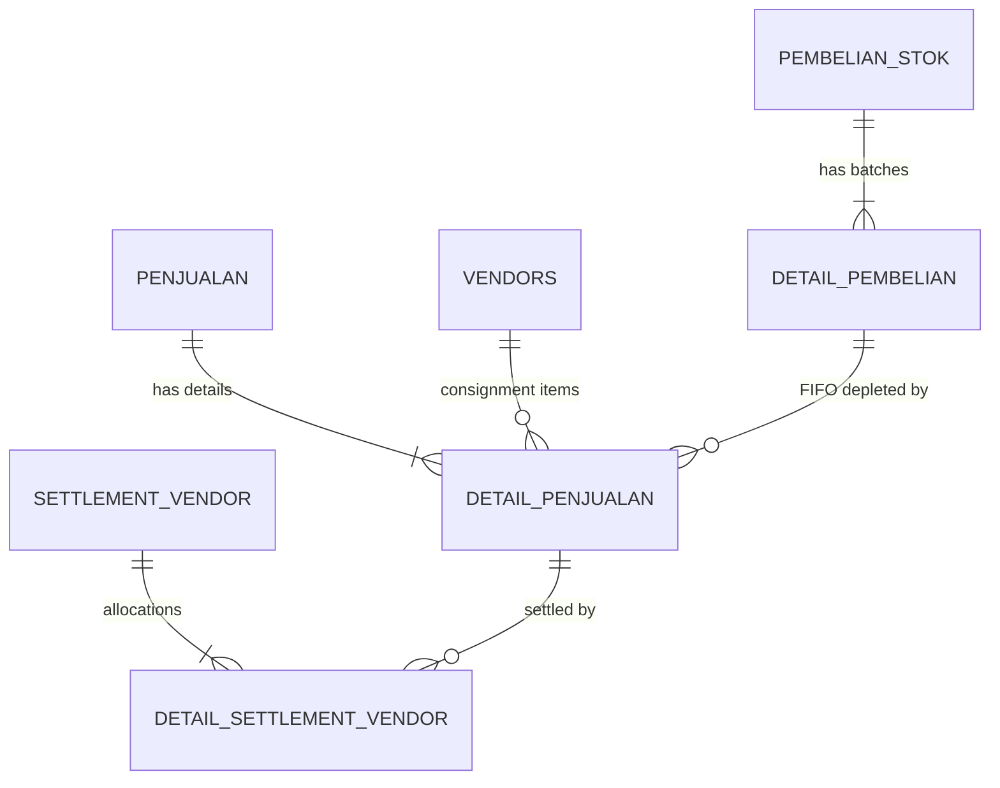
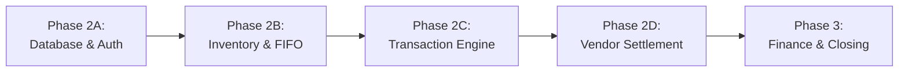

# FINAL PRE-IMPLEMENTATION REVIEW — CROCSCIRCLE.ID
**Pemeriksaan Akhir Arsitektur, Skema Database, dan Kesiapan Sistem Sebelum Implementasi Backend**

**Tanggal:** 17 November 2026  
**Status:** DITINJAU & DISEMPURNAKAN (Kesiapan Menuju Phase 2A)

---

## 1. PENDAHULUAN & TUJUAN

Dokumen ini disusun sebagai evaluasi menyeluruh terhadap seluruh artefak desain CrocsCircle.ID sebelum baris kode backend dieksekusi:
- [VENDOR_RULES_AND_PRICE_FLEXIBILITY.md](file:///D:/Documents/GitHub/CrocsCircle-Website/docs/audit/VENDOR_RULES_AND_PRICE_FLEXIBILITY.md)
- [schema.json](file:///D:/Documents/GitHub/CrocsCircle-Website/database/schema.json)
- [InitDatabase.gs](file:///D:/Documents/GitHub/CrocsCircle-Website/src/backend/InitDatabase.gs)
- [PHASE_1_AUDIT_AND_DESIGN.md](file:///D:/Documents/GitHub/CrocsCircle-Website/docs/audit/PHASE_1_AUDIT_AND_DESIGN.md)

Tujuan utama dari pemeriksaan ini adalah menemukan celah logis, potensi konflik konkurensi, kegagalan rekonsiliasi kas, serta memastikan skema database benar-benar tahan uji untuk seluruh skenario transaksi riil.

---

## 2. HASIL PEMERIKSAAN PADA 10 AREA KRITIS

### AREA 1: KONSISTENSI TABEL, PRIMARY KEY, FOREIGN KEY & RELASI MULTI-BATCH
- **Kondisi Awal:** `DETAIL_PENJUALAN` memiliki kolom `batch_id` yang mengasumsikan 1 baris item selalu berasal dari 1 batch pembelian.
- **Temuan Celah (Split-Batch Sale):**
  Jika customer membeli 2 pasang *Crocs Classic Black M8*, sementara Batch A tertua hanya tersisa 1 pasang (modal Rp150.000) dan Batch B memiliki sisa 5 pasang (modal Rp160.000):
  *Risiko:* Jika sistem membatasi 1 baris untuk 2 pasang, `batch_id` dan `hpp_unit` mana yang dicatat? Jika dirata-rata, kemurnian audit FIFO hilang.
- **Solusi & Rekomendasi:**
  Sistem backend FIFO wajib memecah kuantitas ke dalam beberapa baris detail (`DETAIL_PENJUALAN`) jika satu pesanan mengonsumsi lebih dari satu batch:
  - Baris 1: Qty 1, Batch A, HPP Rp150.000
  - Baris 2: Qty 1, Batch B, HPP Rp160.000
  Kedua baris mengacu pada `sales_id` yang sama. Dengan demikian, snapshot HPP historis per unit tetap 100% presisi.

---

### AREA 2: PENERAPAN FIFO BERDASARKAN BATCH & `remaining_qty`
- **Kondisi:** Setiap baris `DETAIL_PEMBELIAN` mencatat `quantity` (kuantitas masuk awal) dan `remaining_qty` (sisa unit belum terjual).
- **Temuan Celah (Overselling & Race Condition):**
  Jika dua admin/kasir di bazar mengonfirmasi penjualan produk yang sama pada detik yang hampir bersamaan ketika sisa stok tinggal 1 pasang:
  *Risiko:* Kedua transaksi bisa membaca `remaining_qty = 1`, keduanya berhasil, dan stok batch menjadi negatif (-1).
- **Solusi & Rekomendasi:**
  1. Operasi pengurangan FIFO wajib dibungkus dengan `LockService.getScriptLock()` dengan timeout 30 detik.
  2. Sebelum memotong `remaining_qty`, sistem melakukan validasi ketersediaan total:
     $$\sum \text{remaining\_qty} \ge \text{quantity\_diminta}$$
  3. Jika stok tidak mencukupi, transaksi ditolak dan dibatalkan sebelum mutasi apa pun ditulis ke database.

---

### AREA 3: SNAPSHOT HARGA JUAL AKTUAL & HPP PADA TRANSAKSI
- **Kondisi:** Harga jual katalog (`catalog_price`) hanya menjadi nilai referensi.
- **Pemeriksaan:**
  - `DETAIL_PENJUALAN` menyimpan `selling_price` aktual yang diinput admin.
  - `DETAIL_PENJUALAN` menyimpan `hpp_unit` dari batch asal.
  - `DETAIL_PENJUALAN` menyimpan `vendor_payable_unit` dan `crocs_incentive_unit`.
- **Hasil Review:** **VALID & AMAN.** Perubahan harga katalog di masa depan tidak akan memengaruhi transaksi masa lalu.

---

### AREA 4: PEMISAHAN KEPEMILIKAN STOK (SENDIRI VS VENDOR)
- **Kondisi Awal:** Tabel `STOK` memiliki `owned_physical_stock` dan `consignment_physical_stock`.
- **Temuan Celah (Reservasi PO Bercampur):**
  Kolom `reserved_stock` sebelumnya disatukan dalam satu angka. Jika ada PO customer yang di-booking, tidak jelas apakah yang di-booking adalah barang milik sendiri atau barang titipan vendor.
- **Solusi & Rekomendasi:**
  Pecah `reserved_stock` dan `available_stock` pada tabel `STOK` menjadi:
  - `owned_physical_stock`
  - `owned_reserved_stock`
  - `owned_available_stock` $= \text{owned\_physical\_stock} - \text{owned\_reserved\_stock}$
  - `consignment_physical_stock`
  - `consignment_reserved_stock`
  - `consignment_available_stock` $= \text{consignment\_physical\_stock} - \text{consignment\_reserved\_stock}$
  *Manfaat:* Kasir tidak akan pernah salah menjual barang titipan vendor saat berniat menjual stok milik CrocsCircle, atau sebaliknya.

---

### AREA 5: PEMISAHAN PENDAPATAN INSENTIF VS KEWAJIBAN VENDOR & KAS TERBATAS (RESTRICTED CASH)
- **Kondisi:** Customer membayar Rp280.000 untuk barang konsinyasi Dzaki. Kas bank bertambah Rp280.000.
- **Temuan Celah (Pengecoh Saldo Kas Bank):**
  Jika kasir/owner hanya melihat saldo mutasi bank (+Rp280.000), ada risiko psikologis menganggap seluruh uang tersebut adalah uang bebas (unrestricted cash) milik CrocsCircle yang bisa dipakai belanja atau dibagi hasil.
- **Solusi & Rekomendasi:**
  Pada Dashboard Keuangan internal, sediakan metrik **"Restricted Cash / Kas Terikat Kewajiban Vendor"**:
  $$\text{Kas Riil di Bank} = \text{Kas Bebas Operasional CrocsCircle} + \text{Hutang Vendor Belum Disetor}$$
  Sistem secara eksplisit menampilkan bahwa Rp270.000 adalah titipan/kewajiban yang tidak boleh dibagikan ke Owner saat tutup buku.

---

### AREA 6: DUKUNGAN PEMBAYARAN VENDOR PARSIAL & GABUNGAN (MULTI-TRANSACTION SETTLEMENT)
- **Kondisi Awal:** Kolom `settlement_id` hanya diletakkan pada tabel `DETAIL_PENJUALAN`.
- **Temuan Celah Kritis (Pembayaran Parsial):**
  Jika CrocsCircle memiliki kewajiban total Rp1.080.000 (dari 4 pasang sepatu @ Rp270.000), lalu mentransfer Rp500.000 terlebih dahulu ke Dzaki:
  *Masalah:* Satu transfer Rp500.000 tidak bisa membagi ID secara rapi ke 4 baris penjualan jika hanya ada 1 kolom `settlement_id` berstatus `PAID`/`UNPAID`.
- **Solusi & Rekomendasi:**
  Tambahkan tabel junction **Tabel 21: `DETAIL_SETTLEMENT_VENDOR`**:
  - `settlement_detail_id` (PK)
  - `settlement_id` (FK ke `SETTLEMENT_VENDOR`)
  - `sales_detail_id` (FK ke `DETAIL_PENJUALAN`)
  - `amount_allocated` (Nominal rupiah yang dialokasikan ke item ini)
  - `notes`
  Pada `DETAIL_PENJUALAN`, tambahkan kolom:
  - `total_vendor_payable` (Hak vendor total, misal Rp270.000)
  - `vendor_paid_amount` (Akumulasi yang sudah disetor)
  - `vendor_remaining_payable` $= \text{total\_vendor\_payable} - \text{vendor\_paid\_amount}$
  - `settlement_status` (`UNPAID` jika sisa = total, `PARTIAL` jika $0 < \text{sisa} < \text{total}$, `PAID` jika sisa = 0).
  *Hasil:* Mendukung pembayaran sebagian, pembayaran bertahap, dan 1 transfer bank untuk melunasi puluhan transaksi sekaligus secara akuntabel.

---

### AREA 7: PENANGANAN RETUR, PEMBATALAN & KOREKSI TRANSAKSI
- **Skenario A (Retur Barang Milik Sendiri):**
  - Stok dikembalikan ke batch asal (`batch_id` yang tercatat di `DETAIL_PENJUALAN`).
  - Kolom `remaining_qty` pada batch tersebut ditambah kembali: `remaining_qty += qty_retur`.
  - Omzet dan HPP dibalik (reversal) pada periode berjalan.
- **Skenario B (Retur Barang Konsinyasi Vendor):**
  - Stok konsinyasi bertambah kembali: `consignment_physical_stock += qty_retur`.
  - Jika hak vendor statusnya masih `UNPAID`: Kewajiban langsung dibatalkan (`settlement_status = CANCELLED`).
  - Jika hak vendor sudah terlanjur ditransfer ke Dzaki (`PAID`): Sistem otomatis menerbitkan **Klaim Pengembalian Dana Vendor (Vendor Receivable)** yang otomatis memotong total transfer pada settlement berikutnya.
  - Insentif CrocsCircle Rp10.000 dibatalkan/dibalik.

---

### AREA 8: PENCEGAHAN DOUBLE DEDUCTION STOK & DOUBLE SUBMISSION
- **Celah:** Tombol "Konfirmasi Penjualan" diklik 2 kali oleh admin atau terjadi gangguan jaringan (timeout retry).
- **Solusi & Rekomendasi:**
  1. Frontend menyematkan `idempotency_key` (UUID unik) pada setiap pengiriman transaksi.
  2. Backend memeriksa apakah `idempotency_key` tersebut sudah pernah diproses dalam 10 menit terakhir. Jika ya, backend mengembalikan hasil transaksi yang sudah tersimpan tanpa memotong stok atau menambah omzet untuk kedua kalinya.

---

### AREA 9: REKONSILIASI KAS, PERSEDIAAN, UTANG VENDOR & LABA
- **Model Persamaan Integritas Keuangan CrocsCircle:**
  Setiap penutupan buku bulanan memverifikasi kebenaran formula kesetimbangan:
  $$\text{Kas Akhir Riil} = \text{Kas Awal} + \text{Total Kas Masuk} - \text{Total Kas Keluar}$$
  $$\text{Total Kas Keluar} = \text{Pembelian Stok} + \text{Settlement Vendor} + \text{Beban Operasional} + \text{Prive/Alokasi Owner}$$
  $$\text{Kas Akhir Riil} = \text{Hutang Vendor Belum Dibayar} + \text{Akumulasi Dana Darurat} + \text{Akumulasi Keuntungan Ditahan} + \text{Kas Bebas Bersih}$$
  Jika persamaan ini selisih walau Rp1, sistem menandai sebagai *Warning Rekonsiliasi* untuk diaudit Owner sebelum status periode diubah menjadi `CLOSED`.

---

### AREA 10: KEAMANAN AUTENTIKASI OWNER & ADMIN
- **Pemeriksaan:**
  - Password disimpan menggunakan salt acak per akun + hash SHA-256.
  - Sesi login menggunakan token sementara bertenggang waktu (session token dengan TTL 8 jam).
  - Backend memvalidasi role pada setiap RPC API:
    - `ADMIN` dilarang memanggil fungsi `executeMonthlyClosing`, `updateProfitPercentages`, `reopenFinancialPeriod`, dan `viewProfitAllocationSnapshot`.
    - Panggilan tidak sah menghasilkan `HTTP 403 Forbidden` dan dicatat ke `LOG_AKTIVITAS`.

---

## 3. PENYEMPURNAAN STRUKTUR DATABASE (TOTAL 21 TABEL)

Berdasarkan hasil review Area 6, struktur database disempurnakan dari 20 tabel menjadi **21 tabel** dengan penambahan tabel junction:

### Tabel Baru (Tabel 21): `DETAIL_SETTLEMENT_VENDOR`
| Kolom | Tipe Data | Kunci | Keterangan |
|---|---|---|---|
| `settlement_detail_id` | STRING | PK | Contoh: `STLD-202611-0001` |
| `settlement_id` | STRING | FK | Relasi ke `SETTLEMENT_VENDOR.settlement_id` |
| `sales_detail_id` | STRING | FK | Relasi ke `DETAIL_PENJUALAN.sales_detail_id` |
| `amount_allocated` | NUMBER | | Nominal pembayaran yang dialokasikan ke item ini |
| `notes` | STRING | | Keterangan ("Pelunasan", "Pembayaran Tahap 1") |

### Kolom yang Diperbarui pada `DETAIL_PENJUALAN`:
- `total_vendor_payable` (Hak vendor kotor per baris)
- `vendor_paid_amount` (Nominal yang sudah ditransfer ke vendor)
- `vendor_remaining_payable` (Sisa kewajiban yang belum disetor)
- `settlement_status` (`NOT_APPLICABLE`, `UNPAID`, `PARTIAL`, `PAID`, `CANCELLED`)

### Kolom yang Diperbarui pada `STOK`:
- `owned_physical_stock`
- `owned_reserved_stock`
- `owned_available_stock`
- `consignment_physical_stock`
- `consignment_reserved_stock`
- `consignment_available_stock`
- `total_available_stock`

---

## 4. STATUS KESIAPAN BACKEND & ROADMAP IMPLEMENTASI BERTAHAP

Backend siap dibangun dengan pendekatan modular bertahap (tidak sekaligus) untuk memastikan setiap layer stabil dan teruji:

### Urutan Implementasi Bertahap:
1. **Phase 2A — Database & Authentication Engine**
   - Menjalankan skrip inisialisasi 21 tabel Google Sheets.
   - Mengimplementasikan `AuthService.gs` (Login, verify hash, create session token, role authorization guard).
   - Mengimplementasikan `DatabaseHelper.gs` (CRUD aman, validasi kolom, query helper).
2. **Phase 2B — Inventory Engine & FIFO Depletion**
   - Mengimplementasikan `InventoryService.gs`.
   - Mutasi stok fisik, pemisahan stok sendiri vs konsinyasi vendor.
   - Mesin FIFO otomatis berdasarkan `purchase_detail_id` dan `remaining_qty`.
   - Penguncian `LockService` anti-overselling.
3. **Phase 2C — Transaction Engine (Sales & Pre-Order)**
   - Mengimplementasikan `SalesService.gs` & `POService.gs`.
   - Penjualan harga aktual kesepakatan (snapshot historis).
   - Penjualan stok sendiri (akui omzet & HPP) vs penjualan konsinyasi (akui insentif Rp10k & kewajiban hutang Rp270k).
   - Logika PO (DP vs Pelunasan, `settlement_date` sebagai pengakuan omzet).
   - Mekanisme retur barang dan pembatalan transaksi.
4. **Phase 2D — Vendor Management & Settlement Engine**
   - Mengimplementasikan `VendorService.gs`.
   - Manajemen master vendor & tarif insentif.
   - Rekapitulasi kewajiban vendor belum disetor (Restricted Cash).
   - Eksekusi settlement gabungan & parsial dengan pencatatan ke `DETAIL_SETTLEMENT_VENDOR`.
5. **Phase 3 — Financial Engine & Monthly Closing**
   - Mengimplementasikan `FinancialService.gs` & `ClosingService.gs`.
   - Perhitungan otomatis Pendapatan Bersih Operasional, HPP, Laba Kotor, Pengeluaran, dan Laba Bersih.
   - Alokasi Laba Bersih (20%, 20%, 10%, 50%) dan akumulasi `SALDO_DANA`.
   - Mekanisme Tutup Buku Bulanan, penguncian periode `CLOSED`, dan audit trail Reopen Period.
   - API JSON dispatcher untuk Customer Storefront & Admin Dashboard.
