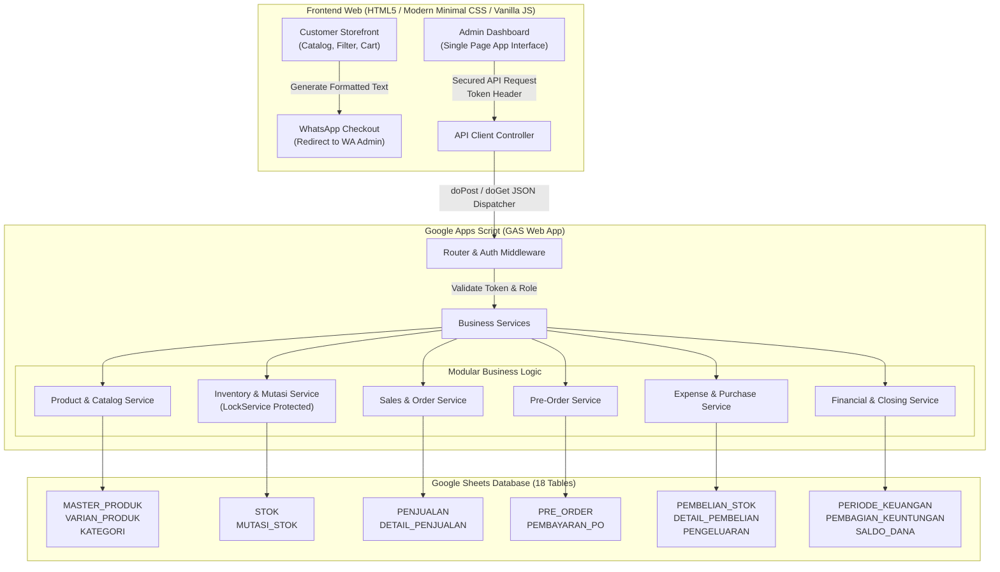

# PHASE 1 — AUDIT DATA LAMA & RANCANGAN ARSITEKTUR DATABASE CROCSCIRCLE.ID

Dokumen ini disusun sebagai hasil analisis menyeluruh terhadap data lama dari spreadsheet `CROCSCIRCLE.ID(1).xlsx` dan perancangan database terintegrasi baru sesuai Master Prompt CrocsCircle.ID.

---

## 1. HASIL AUDIT WORKBOOK LAMA (`CROCSCIRCLE.ID(1).xlsx`)

### A. Ringkasan Sheet yang Dianalisis
| Nama Sheet Lama | Fungsi di Spreadsheet Lama | Kondisi & Temuan Kritis |
|---|---|---|
| **DASHBOARD** | Ringkasan kartu metrik | Hanya placeholder statis tanpa formula otomatis yang terhubung rapi. |
| **Stok** | Pencatatan 44 item fisik sepatu | Mencampur status `In Stock` (24 pasang) dan `Sold Out` (20 pasang). Terdapat barang milik pihak ketiga (**Jaki/Dzaki**, baris 29–37) yang tercampur dengan stok modal CrocsCircle. HPP dicatat manual per baris tanpa ID varian. |
| **CRM - Pre Order** | 4 Batch pemesanan PO pelanggan | Mencatat nama, nomor WA, DP, dan status bayar. Ditemukan error rumus Excel (`#VALUE!` pada baris Ka Ozi) dan inkonsistensi status (contoh: Ka Hasbi dicatat `BAYAR FULL` tetapi update bayar baru 140.000 dari total 280.000 / sebenarnya DP 50%). |
| **Pemasukan Keseluruhan** | Arus kas masuk (Kas + Rekening) | Total pemasukan tercatat Rp6.885.494. Mencampur aduk antara **Setoran Modal Awal** (Hafiz Rp1,5 jt + Harits Rp1,5 jt), pembayaran PO, dan penjualan offline mingguan. |
| **Pengeluaran Keseluruhan** | Arus kas keluar | Total pengeluaran tercatat Rp6.048.410. **Kritikal:** Mencampur aduk antara **Pembelian Aset/Stok Persediaan** (misal: Pembelian Crocs 10 pasang Rp1.825.000, Spiderman 4 pasang Rp940.530) dengan **Biaya Operasional Nyata** (bensin, sewa lapak, banner, keamanan). |
| **Sheet ngebalance in** | Rekonsiliasi kas vs saldo rekening | Saldo akhir riil Rp1.167.083. Memperlihatkan bahwa pencatatan kas dipegang oleh beberapa personil (Hafiz, Harits) dan perlu reimbursement berkala. |
| **BARANG DZAKI** | Catatan titipan jual / konsinyasi | 4 pasang sepatu terjual pada Mingguan 3 (15 Nov 2026) senilai Rp1.310.000. Harus dipisahkan dari omzet murni CrocsCircle agar HPP dan laba bersih tidak bias. |
| **Bulan Oktober** | Laporan bulanan perdana (Oktober 2026) | Total Omzet PO Lunas: Rp290.000, Total HPP: Rp124.000, Laba Kotor: Rp166.000, Pengeluaran Operasional: Rp61.000, Laba Bersih: Rp105.000. **Temuan:** Dana darurat dihitung 10% dari sisa keuntungan (Rp6.300 = 6% laba bersih), bukan 10% dari laba bersih sesuai Master Prompt. |
| **Bulan November** | Laporan berjalan (November 2026) | Total Omzet Offline: Rp4.970.000, Omzet PO Lunas: Rp2.200.000, Total Omzet: Rp7.170.000, Total HPP: Rp3.552.171, Laba Kotor: Rp3.617.829, Pengeluaran: Rp497.260, Laba Bersih: Rp3.120.569. |

---

### B. Temuan Kritis & Rekomendasi Solusi Bisnis

1. **Pemisahan Pembelian Stok Supplier vs Pengeluaran Operasional**
   - *Masalah Lama:* Pembelian stok sepatu (contoh: Rp1.825.000 dan Rp940.530) dimasukkan ke sheet `Pengeluaran Keseluruhan` seolah-olah biaya operasional yang langsung memotong laba.
   - *Solusi Master Prompt:* Pembelian stok masuk ke tabel `PEMBELIAN_STOK` dan `DETAIL_PEMBELIAN` sebagai aset persediaan (Inventory). Beban keuangan hanya diakui sebagai **HPP (Harga Pokok Penjualan)** ketika barang tersebut benar-benar **terjual** di tabel `PENJUALAN` atau pelunasan `PRE_ORDER`.
   - *Dampak:* Laba bersih operasional menjadi akurat, tidak anjlok saat restock besar.

2. **Perbedaan Rumus Alokasi Keuntungan (Bulan Oktober vs Master Prompt)**
   - *Kondisi Lama:* Di sheet Oktober & November lama, rumusnya:
     - Gaji Hafiz: 20%
     - Gaji Harits: 20%
     - Sisa Keuntungan: 60%
     - Dana Darurat: 10% dari Sisa Keuntungan (= 6% dari Laba Bersih)
     - Sisa Keuntungan tidak dialokasikan secara eksplisit (hanya angka sisa).
   - *Ketentuan Master Prompt (Baku & Mengikat):*
     - Owner 1 (Hafiz): **20%** dari Laba Bersih
     - Owner 2 (Harits): **20%** dari Laba Bersih
     - Dana Darurat: **10%** dari Laba Bersih
     - Keuntungan Ditahan (Retained Earnings): **50%** dari Laba Bersih
     - **Total = 100%**. Jika Laba Bersih <= 0, semua alokasi = 0.

3. **Status Barang Titipan / Konsinyasi (Barang Dzaki/Jaki)**
   - *Kondisi Lama:* Stok sepatu milik Dzaki dimasukkan ke sheet stok umum hanya dengan kolom `Punya: Jaki`.
   - *Solusi Baru:* Pada tabel `VARIAN_PRODUK` atau `PEMBELIAN_STOK`, tambahkan kolom atau referensi kepemilikan/supplier (`ownership: OWNED vs CONSIGNMENT`). Transaksi konsinyasi memiliki perlakuan HPP khusus di mana HPP adalah hak bagi hasil pemilik barang.

4. **Pengakuan Omzet Pre-Order (PO)**
   - *Kondisi Lama:* Pembayaran DP sering kali langsung dijumlahkan ke arus kas bulanan dan membingungkan penghitungan laba kotor karena HPP barang belum tentu keluar.
   - *Solusi Master Prompt:*
     - Uang DP dicatat di `PEMBAYARAN_PO`, namun **BUKAN omzet penjualan**.
     - Omzet PO diakui **hanya saat pembayaran LUNAS**.
     - Tanggal pengakuan omzet = `settlement_date` (tanggal lunas).
     - HPP produk PO diakui pada bulan pelunasan tersebut.

5. **Pemisahan Stok Fisik (Physical), Dipesan (Reserved), dan Siap Jual (Available)**
   - *Kondisi Lama:* Hanya ada status `In Stock` atau `Sold Out`. Saat barang PO tiba, tidak ada penanda bahwa barang tersebut sudah menjadi milik pemesan PO tertentu, sehingga rawan terjual di bazar offline.
   - *Solusi Baru:*
     $$\text{Available Stock} = \text{Physical Stock} - \text{Reserved Stock}$$
     Barang PO yang sudah datang fisik masuk `Physical Stock` + `Reserved Stock` (Available Stock = 0).

---

## 2. RANCANGAN SKEMA DATABASE BARU (GOOGLE SHEETS)

Database baru dibuat **100% dari awal** di Google Sheets baru khusus CrocsCircle.
Seluruh tabel menggunakan relasi ID unik berbasis prefix standar:
- Produk: `PRD-xxx`
- Varian: `VAR-xxx`
- Kategori: `CAT-xxx`
- Mutasi Stok: `STK-MOV-xxx`
- Penjualan: `SLS-xxx`
- Detail Penjualan: `SLSD-xxx`
- Pre-Order: `PO-xxx`
- Pembayaran PO: `POP-xxx`
- Pembelian Stok: `PUR-xxx`
- Detail Pembelian: `PURD-xxx`
- Pengeluaran: `EXP-xxx`
- Periode Keuangan: `PER-YYYY-MM`
- Alokasi Keuntungan: `ALC-YYYY-MM`
- Saldo Dana: `FND-xxx`
- User: `USR-xxx`
- Log: `LOG-xxx`

---

### TABEL 1: MASTER_PRODUK
Menyimpan data induk model/desain produk Crocs dan aksesori (Jibbitz/Gbits).

| Kolom | Tipe Data | Kunci | Keterangan |
|---|---|---|---|
| `product_id` | STRING | PK | Contoh: `PRD-001`, `PRD-002` |
| `product_name` | STRING | | Nama display produk (contoh: "Crocs Classic Clog") |
| `category_id` | STRING | FK | Referensi ke `KATEGORI.category_id` |
| `model` | STRING | | Model sepatu (contoh: "Classic", "Bape", "Mcqueen", "Loopy", "Platform") |
| `description` | STRING | | Deskripsi produk untuk customer storefront |
| `image_url` | STRING | | URL gambar utama produk |
| `sales_type` | ENUM | | `READY_STOCK`, `PRE_ORDER`, atau `BOTH` |
| `is_active` | BOOLEAN | | TRUE jika produk masih dipasarkan |
| `is_published` | BOOLEAN | | TRUE jika tampil di katalog publik website |
| `created_at` | DATETIME | | Waktu pembuatan record |
| `updated_at` | DATETIME | | Waktu pembaruan terakhir |

---

### TABEL 2: VARIAN_PRODUK
Menyimpan kombinasi warna, ukuran, dan penetapan harga dasar serta HPP.

| Kolom | Tipe Data | Kunci | Keterangan |
|---|---|---|---|
| `variant_id` | STRING | PK | Contoh: `VAR-001`, `VAR-002` |
| `product_id` | STRING | FK | Relasi ke `MASTER_PRODUK.product_id` |
| `color` | STRING | | Warna (contoh: "Hitam", "Pink", "Bone", "Taupe") |
| `size` | STRING | | Ukuran (contoh: "M8/W10 (41-42)", "W6", "M9") |
| `sku` | STRING | | SKU internal unik (contoh: `CC-CLS-BLK-M8`) |
| `unit` | STRING | | Satuan ("Pasang" untuk sepatu, "Pcs" untuk Gbits) |
| `selling_price`| NUMBER | | Harga jual standar (contoh: 280000, 380000) |
| `unit_hpp` | NUMBER | | HPP modal dasar (contoh: 120000, 230000) |
| `ownership` | ENUM | | `OWNED` (CrocsCircle) atau `CONSIGNMENT` (Jaki/Dzaki) |
| `is_active` | BOOLEAN | | TRUE jika varian masih aktif dijual |

---

### TABEL 3: STOK
Menyimpan snapshot saldo stok per varian barang fisik.

| Kolom | Tipe Data | Kunci | Keterangan |
|---|---|---|---|
| `variant_id` | STRING | PK, FK | Relasi ke `VARIAN_PRODUK.variant_id` |
| `physical_stock`| NUMBER | | Stok fisik riil di gudang/toko (>= 0) |
| `reserved_stock`| NUMBER | | Stok fisik yang sudah di-booking untuk customer PO (>= 0) |
| `available_stock`| FORMULA | | `= physical_stock - reserved_stock` (Siap jual online/offline) |
| `minimum_stock`| NUMBER | | Ambang batas peringatan stok menipis (default: 1 atau 2) |
| `updated_at` | DATETIME | | Timestamp perubahan stok terakhir |

*Validasi Ketat:*
- `physical_stock` tidak boleh negatif.
- `reserved_stock` tidak boleh melebihi `physical_stock`.
- `available_stock` dihitung otomatis, tidak boleh diedit manual.

---

### TABEL 4: MUTASI_STOK
Audit trail riwayat mutasi persediaan (Stock Ledger). Setiap penambahan/pengurangan stok WAJIB mencatat baris di tabel ini.

| Kolom | Tipe Data | Kunci | Keterangan |
|---|---|---|---|
| `movement_id` | STRING | PK | Contoh: `MOV-202611-001` |
| `movement_date`| DATETIME | | Tanggal & waktu mutasi fisik terjadi |
| `variant_id` | STRING | FK | Relasi ke varian produk |
| `movement_type`| ENUM | | `STOCK_IN`, `STOCK_OUT`, `RESERVE`, `RELEASE_RESERVE`, `ADJUSTMENT`, `RETURN` |
| `quantity` | NUMBER | | Jumlah perubahan (positif/negatif sesuai tipe) |
| `reference_type`| STRING | | `SALES`, `PRE_ORDER`, `PURCHASE`, `MANUAL_ADJUSTMENT` |
| `reference_id` | STRING | | ID transaksi terkait (contoh: `SLS-xxx`, `PO-xxx`, `PUR-xxx`) |
| `notes` | STRING | | Alasan/keterangan mutasi |
| `created_by` | STRING | | User ID Admin/Owner yang melakukan mutasi |
| `created_at` | DATETIME | | Waktu record tersimpan |

---

### TABEL 5: PENJUALAN
Menyimpan transaksi penjualan offline, bazar mingguan, event, atau pemesanan langsung Ready Stock yang telah dikonfirmasi.

| Kolom | Tipe Data | Kunci | Keterangan |
|---|---|---|---|
| `sales_id` | STRING | PK | Contoh: `SLS-202611-001` |
| `transaction_date`| DATE | | Tanggal transaksi |
| `sales_channel`| ENUM | | `OFFLINE_EVENT`, `WEEKLY_MARKET`, `WHATSAPP`, `OTHER` |
| `sales_type` | ENUM | | `READY_STOCK` (atau `PO_SETTLEMENT` jika melalui settlement PO) |
| `customer_name`| STRING | | Nama pembeli (opsional/jika ada) |
| `payment_method`| ENUM | | `QRIS`, `CASH`, `TRANSFER`, `OTHER` |
| `payment_status`| ENUM | | `LUNAS` |
| `total_sales` | NUMBER | | Total omzet kotor transaksi |
| `total_hpp` | NUMBER | | Total akumulasi HPP item dalam transaksi ini |
| `gross_profit` | FORMULA | | `= total_sales - total_hpp` |
| `notes` | STRING | | Lokasi bazar/kegiatan (contoh: "Mingguan 3") |
| `created_by` | STRING | | Akun kasir/admin penanggung jawab |
| `created_at` | DATETIME | | Waktu input transaksi |

---

### TABEL 6: DETAIL_PENJUALAN
Rincian item produk yang terjual dalam satu transaksi.

| Kolom | Tipe Data | Kunci | Keterangan |
|---|---|---|---|
| `sales_detail_id`| STRING | PK | Contoh: `SLSD-001` |
| `sales_id` | STRING | FK | Relasi ke `PENJUALAN.sales_id` |
| `variant_id` | STRING | FK | Relasi ke `VARIAN_PRODUK.variant_id` |
| `quantity` | NUMBER | | Jumlah unit terjual |
| `selling_price`| NUMBER | | Harga jual satuan saat transaksi |
| `hpp_unit` | NUMBER | | HPP satuan saat transaksi |
| `subtotal` | NUMBER | | `= quantity * selling_price` |
| `total_hpp` | NUMBER | | `= quantity * hpp_unit` |

---

### TABEL 7: PRE_ORDER
Pencatatan pemesanan sistem Pre-Order. Memiliki 3 dimensi status yang saling independen: Pembayaran, Pengadaan Supplier, dan Penyerahan ke Pelanggan.

| Kolom | Tipe Data | Kunci | Keterangan |
|---|---|---|---|
| `po_id` | STRING | PK | Contoh: `PO-202611-001` |
| `order_date` | DATE | | Tanggal pemesanan dibuat |
| `customer_name`| STRING | | Nama pelanggan |
| `customer_contact`| STRING | | Nomor WhatsApp pelanggan |
| `variant_id` | STRING | FK | Produk & varian yang dipesan |
| `quantity` | NUMBER | | Jumlah pasang/pcs |
| `selling_price`| NUMBER | | Harga jual satuan yang disepakati |
| `total_order` | NUMBER | | `= quantity * selling_price` |
| `supplier` | STRING | | Nama vendor supplier pemesanan |
| `estimated_arrival`| DATE | | Estimasi kedatangan barang |
| `payment_status`| ENUM | | `BELUM_BAYAR`, `DP`, `LUNAS` |
| `procurement_status`| ENUM | | `BELUM_DIPESAN`, `DIPESAN`, `DALAM_PERJALANAN`, `DITERIMA` |
| `fulfillment_status`| ENUM | | `BELUM_DISERAHKAN`, `SUDAH_DISERAHKAN`, `DIBATALKAN` |
| `settlement_date`| DATE | | **Tanggal pelunasan (Penentu tanggal pengakuan omzet!)** |
| `notes` | STRING | | Catatan batch PO / varian khusus |
| `created_by` | STRING | | PIC PO (contoh: "Hafiz", "Harits") |

---

### TABEL 8: PEMBAYARAN_PO
Menyimpan riwayat setiap cicilan pembayaran DP maupun pelunasan dari customer.

| Kolom | Tipe Data | Kunci | Keterangan |
|---|---|---|---|
| `payment_id` | STRING | PK | Contoh: `POP-001` |
| `po_id` | STRING | FK | Relasi ke `PRE_ORDER.po_id` |
| `payment_date` | DATE | | Tanggal penerimaan uang |
| `amount` | NUMBER | | Nominal pembayaran yang masuk |
| `payment_method`| ENUM | | `QRIS`, `TRANSFER`, `CASH` |
| `notes` | STRING | | Keterangan ("DP 50%", "Pelunasan") |
| `created_by` | STRING | | Penanggung jawab penerima |

---

### TABEL 9: PEMBELIAN_STOK
Pencatatan faktur/pembelian pengadaan barang dari vendor/supplier ke CrocsCircle.

| Kolom | Tipe Data | Kunci | Keterangan |
|---|---|---|---|
| `purchase_id` | STRING | PK | Contoh: `PUR-202611-001` |
| `purchase_date`| DATE | | Tanggal order pembelian ke supplier |
| `supplier_name`| STRING | | Nama supplier/vendor (contoh: "Vendor Dzaki", "Shopee") |
| `subtotal` | NUMBER | | Total harga beli barang |
| `shipping_cost`| NUMBER | | Ongkos kirim pengadaan |
| `total_purchase`| NUMBER | | `= subtotal + shipping_cost` |
| `payment_status`| ENUM | | `BELUM_BAYAR`, `DP`, `LUNAS` |
| `receiving_status`| ENUM | | `BELUM_DITERIMA`, `SEBAGIAN_DITERIMA`, `DITERIMA` |
| `notes` | STRING | | Keterangan paket/resi |
| `created_by` | STRING | | PIC pengadaan |

---

### TABEL 10: DETAIL_PEMBELIAN
Rincian varian produk dan kuantitas yang dibeli dari supplier.

| Kolom | Tipe Data | Kunci | Keterangan |
|---|---|---|---|
| `purchase_detail_id`| STRING | PK | Contoh: `PURD-001` |
| `purchase_id` | STRING | FK | Relasi ke `PEMBELIAN_STOK.purchase_id` |
| `variant_id` | STRING | FK | Relasi ke `VARIAN_PRODUK.variant_id` |
| `quantity` | NUMBER | | Jumlah unit yang dibeli |
| `unit_cost` | NUMBER | | Harga modal beli per pasang/unit |
| `subtotal` | NUMBER | | `= quantity * unit_cost` |

---

### TABEL 11: PENGELUARAN
Pencatatan beban operasional bisnis murni. **Tidak mencakup pembelian stok sepatu.**

| Kolom | Tipe Data | Kunci | Keterangan |
|---|---|---|---|
| `expense_id` | STRING | PK | Contoh: `EXP-202611-001` |
| `expense_date` | DATE | | Tanggal pengeluaran |
| `category` | ENUM | | `TRANSPORTASI`, `SEWA`, `ADMINISTRASI`, `KONSUMSI`, `MARKETING`, `PERLENGKAPAN`, `BIAYA_EVENT`, `LAINNYA` |
| `activity` | STRING | | Kegiatan terkait (contoh: "Mingguan 1", "Operasional Toko") |
| `description` | STRING | | Rincian ("Bensin Mobil Dani", "Sewa Lapak", "Tol", "Banner") |
| `amount` | NUMBER | | Nominal biaya (Rupiah) |
| `payment_method`| ENUM | | `CASH_HARITS`, `CASH_HAFIZ`, `REKENING_CROCSCIRCLE`, `E_MONEY` |
| `paid_by` | STRING | | Nama yang membayarkan di lapangan |
| `receipt_url` | STRING | | Link foto nota/bukti transfer jika ada |
| `notes` | STRING | | Catatan status reimbursement |
| `created_by` | STRING | | User input |

---

### TABEL 12: PEMBAGIAN_KEUNTUNGAN
Menyimpan hasil alokasi laba bersih bulanan resmi yang dibuat saat **Tutup Buku Bulanan**.

| Kolom | Tipe Data | Kunci | Keterangan |
|---|---|---|---|
| `allocation_id`| STRING | PK | Contoh: `ALC-2026-11` |
| `period_id` | STRING | FK | Relasi ke `PERIODE_KEUANGAN.period_id` (contoh: `PER-2026-11`) |
| `net_profit` | NUMBER | | Laba Bersih periode tersebut |
| `owner1_percentage`| NUMBER | | 20.00% |
| `owner1_amount`| NUMBER | | `= MAX(0, net_profit) * 20%` |
| `owner2_percentage`| NUMBER | | 20.00% |
| `owner2_amount`| NUMBER | | `= MAX(0, net_profit) * 20%` |
| `emergency_percentage`| NUMBER | | 10.00% |
| `emergency_amount`| NUMBER | | `= MAX(0, net_profit) * 10%` |
| `retained_percentage` | NUMBER | | 50.00% |
| `retained_amount`| NUMBER | | `= MAX(0, net_profit) * 50%` |
| `allocation_date`| DATETIME | | Waktu penguncian alokasi |
| `status` | ENUM | | `FINAL` (atau `AMENDED` jika pernah dibuka kembali) |

---

### TABEL 13: PERIODE_KEUANGAN
Mengatur status aktif/terkunci setiap bulan akuntansi.

| Kolom | Tipe Data | Kunci | Keterangan |
|---|---|---|---|
| `period_id` | STRING | PK | Format: `PER-YYYY-MM` (contoh: `PER-2026-10`, `PER-2026-11`) |
| `month` | NUMBER | | Angka bulan (1–12) |
| `year` | NUMBER | | Tahun (contoh: 2026) |
| `period_status`| ENUM | | `OPEN` atau `CLOSED` |
| `closing_date` | DATETIME | | Tanggal & jam saat ditutup buku |
| `closed_by` | STRING | | User ID Owner yang mengeksekusi tutup buku |
| `closing_version`| NUMBER | | Versi closing (1, 2 jika reopened) |
| `notes` | STRING | | Catatan penutupan / alasan reopen |

---

### TABEL 14: SALDO_DANA
Buku besar akumulasi saldo **Dana Darurat** dan **Keuntungan Ditahan**.

| Kolom | Tipe Data | Kunci | Keterangan |
|---|---|---|---|
| `fund_transaction_id`| STRING | PK | Contoh: `FND-001` |
| `fund_type` | ENUM | | `DANA_DARURAT` atau `KEUNTUNGAN_DITAHAN` |
| `transaction_date` | DATE | | Tanggal mutasi dana |
| `period_id` | STRING | FK | Periode buku terkait |
| `transaction_type` | ENUM | | `ALLOCATION_IN` (dari profit closing), `USAGE_OUT` (pemakaian darurat/ekspansi) |
| `amount` | NUMBER | | Nominal masuk (+) atau keluar (-) |
| `reference_id` | STRING | | ID alokasi atau ID pengeluaran resmi |
| `notes` | STRING | | Keterangan pemakaian/alokasi |
| `created_by` | STRING | | Akun Owner penanggung jawab |

---

### TABEL 15: USERS
Menyimpan akun pengguna untuk hak akses Owner dan Admin.

| Kolom | Tipe Data | Kunci | Keterangan |
|---|---|---|---|
| `user_id` | STRING | PK | Contoh: `USR-001`, `USR-002` |
| `username` | STRING | UNIQUE | Username login (contoh: `hafiz`, `harits`, `admin1`) |
| `password_hash`| STRING | | Hash SHA-256 ber-salt (Bukan teks biasa!) |
| `role` | ENUM | | `OWNER` atau `ADMIN` |
| `full_name` | STRING | | Nama lengkap pemilik akun |
| `is_active` | BOOLEAN | | TRUE jika akun aktif |
| `created_at` | DATETIME | | Waktu pendaftaran |
| `updated_at` | DATETIME | | Waktu perubahan terakhir |

---

### TABEL 16: PENGATURAN
Menyimpan konfigurasi parameter bisnis yang dinamis.

| Kolom | Tipe Data | Kunci | Keterangan |
|---|---|---|---|
| `setting_key` | STRING | PK | Contoh: `STORE_NAME`, `WHATSAPP_NUMBER`, `OWNER1_PCT`, `OWNER2_PCT`, `EMERGENCY_PCT`, `RETAINED_PCT`, `MIN_STOCK_ALERT` |
| `setting_value`| STRING | | Nilai pengaturan (contoh: `CrocsCircle`, `628123456789`, `20`, `20`, `10`, `50`, `2`) |
| `description` | STRING | | Deskripsi fungsi konfigurasi |
| `updated_by` | STRING | | Akun Owner pengubah |
| `updated_at` | DATETIME | | Timestamp perubahan |

---

### TABEL 17: KATEGORI
Pengelompokan jenis produk.

| Kolom | Tipe Data | Kunci | Keterangan |
|---|---|---|---|
| `category_id` | STRING | PK | Contoh: `CAT-CLOG`, `CAT-COLLAB`, `CAT-PLATFORM`, `CAT-ACCESSORIES` |
| `category_name`| STRING | | Nama kategori (contoh: "Classic Clog", "Collaboration", "Platform", "Jibbitz / Aksesori") |
| `description` | STRING | | Keterangan kategori |
| `is_active` | BOOLEAN | | TRUE jika aktif |

---

### TABEL 18: LOG_AKTIVITAS
Catatan audit trail untuk seluruh operasi penting (Login, Perubahan Stok, Tutup Buku, Reopen Period).

| Kolom | Tipe Data | Kunci | Keterangan |
|---|---|---|---|
| `log_id` | STRING | PK | Contoh: `LOG-202611-0001` |
| `user_id` | STRING | | ID pengguna yang melakukan aksi |
| `action` | STRING | | Contoh: `STOCK_ADJUST`, `SALES_CREATE`, `MONTHLY_CLOSE`, `PERIOD_REOPEN` |
| `module` | STRING | | Modul: `INVENTORY`, `SALES`, `FINANCE`, `SETTING` |
| `reference_id` | STRING | | ID objek yang diubah |
| `description` | STRING | | Rincian perubahan |
| `timestamp` | DATETIME | | Waktu kejadian |

---

## 3. ARSITEKTUR TEKNOLOGI & DATA FLOW

### Mekanisme Keamanan & Integritas:
1. **Google Apps Script LockService**:
   Operasi kritis seperti mutasi stok, konfirmasi penjualan, pelunasan PO, dan tutup buku dibungkus dengan `LockService.getScriptLock()` dengan timeout 30 detik untuk mencegah race conditions saat beberapa kasir/admin mengakses bersamaan.
2. **Server-Side Validation**:
   Frontend tidak pernah dipercaya secara mutlak. Backend Apps Script memvalidasi ketersediaan stok fisik riil sebelum mengurangi stok atau menyimpan transaksi penjualan.
3. **Data HPP & Laba Internal Bersih dari Akses Publik**:
   Endpoint publik untuk customer storefront hanya mengekspos: nama produk, foto, varian warna/ukuran, harga jual, dan status ketersediaan (In Stock / Pre Order). Nilai HPP, harga modal, data supplier, dan laba disaring ketat di backend.
4. **Keamanan Autentikasi**:
   Password pengguna di-hash menggunakan algoritma SHA-256 dengan salt unik. Sesi login menggunakan token terenkripsi sementara yang divalidasi pada setiap panggilan RPC backend.

---

## 4. FORMULA & REKONSILIASI KEUANGAN (VALIDASI BULAN NOVEMBER)

Berdasarkan dataset historis November di sheet lama, berikut formula kalkulasi yang diimplementasikan dalam engine keuangan:

$$\text{Total Omzet} = \text{Omzet Penjualan Offline} + \text{Omzet PO Lunas}$$
$$\text{Laba Kotor} = \text{Total Omzet} - \text{Total HPP Produk Terjual}$$
$$\text{Laba Bersih} = \text{Laba Kotor} - \text{Total Pengeluaran Operasional}$$

Jika $\text{Laba Bersih} > 0$:
- **Owner 1 (Hafiz):** $\text{Laba Bersih} \times 20\%$
- **Owner 2 (Harits):** $\text{Laba Bersih} \times 20\%$
- **Dana Darurat:** $\text{Laba Bersih} \times 10\%$
- **Keuntungan Ditahan:** $\text{Laba Bersih} \times 50\%$

### Uji Angka November 2026:
- Omzet Offline: **Rp4.970.000**
- Omzet PO Lunas: **Rp2.200.000**
- **TOTAL OMZET:** **Rp7.170.000**
- Total HPP Produk Terjual: **Rp3.552.171**
- **LABA KOTOR:** **Rp3.617.829**
- Total Pengeluaran Operasional: **Rp497.260**
- **LABA BERSIH:** **Rp3.120.569**

### Alokasi Keuntungan Resmi Sesuai Master Prompt:
- Owner 1 (20%): **Rp624.113,8** (Pembulatan: Rp624.114)
- Owner 2 (20%): **Rp624.113,8** (Pembulatan: Rp624.114)
- Dana Darurat (10%): **Rp312.056,9** (Pembulatan: Rp312.057)
- Keuntungan Ditahan (50%): **Rp1.560.284,5** (Pembulatan: Rp1.560.284)
- **Total Alokasi:** **Rp3.120.569** (Tepat 100% Laba Bersih, selisih pembulatan terkontrol).

---

## 5. ROADMAP IMPLEMENTASI TAHAP BERIKUTNYA

- [x] **Phase 1: Project Audit & Database Design** (Selesai pada dokumen ini)
- [ ] **Phase 2: Database Initialization & Apps Script Schema Setup**
  - Membuat script setup otomatis (`InitDatabase.gs`) untuk menginisialisasi ke-18 sheet pada spreadsheet Google Sheets baru lengkap dengan header dan styling warna brand (#173B35 & #37B89D).
  - Menyediakan file definisi skema JSON & validator skema.
- [ ] **Phase 3: Backend Foundation (Apps Script Core Engine)**
  - `AuthService.gs`: Login, hash verification, role access validation.
  - `DatabaseHelper.gs`: Query, insert, update, lock management.
  - `InventoryService.gs`: Mutasi stok, available stock calculation.
- [ ] **Phase 4: Admin Management System (Frontend & Controllers)**
  - Dashboard KPI, Manajemen Produk & Varian, Penjualan, PO, Pembelian Supplier, Pengeluaran.
- [ ] **Phase 5: Customer Storefront**
  - Katalog publik modern, filter ukuran/warna, keranjang belanja lokal, generator pesan WhatsApp checkout.
- [ ] **Phase 6 & 7: Financial Engine & Monthly Closing**
  - Perhitungan otomatis laba rugi bulanan, simulasi tutup buku, snapshot penguncian periode, akumulasi saldo dana.
- [ ] **Phase 8 & 9: Data Migration & Testing**
  - Validasi data migrasi, ekspor SheetJS Excel, QA responsif & deployment.
