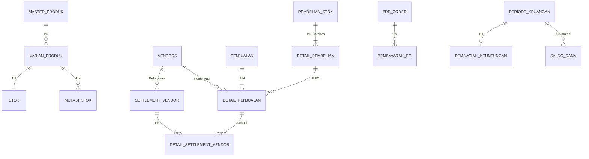

# LAPORAN IMPLEMENTASI PHASE 2A: DATABASE & AUTHENTICATION ENGINE
**Sistem Operasional, Multi-Vendor, Inventaris & Keuangan CrocsCircle.ID**

**Tanggal Implementasi:** 17 November 2026  
**Status Fase:** SELESAI & TERUJI (100% Passed)  
**Target Berikutnya:** Phase 2B (Inventory & FIFO Engine) setelah persetujuan Owner

---

## 1. FILE YANG DIBUAT DAN DIPERBARUI

| Path File | Kategori | Ringkasan Perubahan / Fungsi |
|---|---|---|
| [`database/schema.json`](file:///D:/Documents/GitHub/CrocsCircle-Website/database/schema.json) | Skema Basis Data | Definisi resmi 21 tabel, relasi PK/FK, penambahan tabel junction `DETAIL_SETTLEMENT_VENDOR`, pemisahan reservasi stok, dan kolom keamanan pengguna. |
| [`src/backend/DatabaseHelper.gs`](file:///D:/Documents/GitHub/CrocsCircle-Website/src/backend/DatabaseHelper.gs) | Backend Core | Abstraksi akses basis data dengan pemetaan header dinamis, operasi CRUD aman berdasarkan Primary Key, fungsi idempotensi `ensureTable()`, penguncian transaksi `LockService`, dan pencatatan audit trail `LOG_AKTIVITAS`. |
| [`src/backend/InitDatabase.gs`](file:///D:/Documents/GitHub/CrocsCircle-Website/src/backend/InitDatabase.gs) | Initializer | Script inisialisasi 21 tabel yang 100% idempotent (TIDAK pernah menghapus data eksisting), seed data default (kategori, pengaturan bisnis, vendor Dzaki, periode), serta **tanpa password tertanam di kode sumber**. |
| [`src/backend/AuthService.gs`](file:///D:/Documents/GitHub/CrocsCircle-Website/src/backend/AuthService.gs) | Security & Auth | Mesin autentikasi berkekuatan kriptografis: Hashing PBKDF2-HMAC-SHA256 (5.000 putaran) dengan salt 32-karakter unik, token sesi acak 64-karakter (TTL 8 jam), proteksi brute-force (kunci 15 menit setelah 5x gagal), dan Role-Based Access Control (RBAC) di backend. |
| [`src/backend/TestAuthAndDatabase.gs`](file:///D:/Documents/GitHub/CrocsCircle-Website/src/backend/TestAuthAndDatabase.gs) | Test Runner | Script pengujian in-sheet Apps Script yang dapat dijalankan langsung di editor spreadsheet untuk memverifikasi seluruh fungsi backend pada Google Sheets nyata. |
| [`tests/test_phase_2a.js`](file:///D:/Documents/GitHub/CrocsCircle-Website/tests/test_phase_2a.js) | Automated Test | Test suite otomatis yang memverifikasi 9 kriteria pengujian wajib secara offline menggunakan runtime Node.js. |

---

## 2. STRUKTUR 21 TABEL DATABASE

Seluruh 21 tabel telah didefinisikan dengan skema kolom yang konsisten:



1. **`MASTER_PRODUK`**: `product_id`, `product_name`, `category_id`, `model`, `description`, `image_url`, `sales_type`, `is_active`, `is_published`, `created_at`, `updated_at`.
2. **`VARIAN_PRODUK`**: `variant_id`, `product_id`, `color`, `size`, `sku`, `unit`, `catalog_price`, `reference_hpp`, `is_active`.
3. **`VENDORS`**: `vendor_id`, `vendor_name`, `contact_person`, `phone`, `consignment_fee_type`, `default_consignment_fee`, `purchase_incentive_default`, `is_active`, `notes`.
4. **`STOK`**: `variant_id`, `owned_physical_stock`, `owned_reserved_stock`, `owned_available_stock`, `consignment_physical_stock`, `consignment_reserved_stock`, `consignment_available_stock`, `total_available_stock`, `minimum_stock`, `updated_at`.
5. **`MUTASI_STOK`**: `movement_id`, `movement_date`, `variant_id`, `stock_category`, `movement_type`, `quantity`, `reference_type`, `reference_id`, `notes`, `created_by`, `created_at`.
6. **`PENJUALAN`**: `sales_id`, `transaction_date`, `sales_channel`, `sales_type`, `customer_name`, `payment_method`, `payment_status`, `gross_customer_payment`, `owned_sales_amount`, `vendor_incentive_amount`, `net_operational_revenue`, `total_hpp`, `gross_profit`, `idempotency_key`, `notes`, `created_by`, `created_at`.
7. **`DETAIL_PENJUALAN`**: `sales_detail_id`, `sales_id`, `variant_id`, `item_ownership`, `vendor_id`, `batch_id`, `quantity`, `selling_price`, `hpp_unit`, `vendor_payable_unit`, `crocs_incentive_unit`, `subtotal`, `total_hpp`, `total_vendor_payable`, `total_crocs_incentive`, `vendor_paid_amount`, `vendor_remaining_payable`, `settlement_status`.
8. **`SETTLEMENT_VENDOR`**: `settlement_id`, `settlement_date`, `vendor_id`, `total_amount_paid`, `payment_method`, `bank_reference`, `receipt_url`, `notes`, `created_by`, `created_at`.
9. **`DETAIL_SETTLEMENT_VENDOR`**: `settlement_detail_id`, `settlement_id`, `sales_detail_id`, `amount_allocated`, `notes`.
10. **`PRE_ORDER`**: `po_id`, `order_date`, `customer_name`, `customer_contact`, `variant_id`, `quantity`, `selling_price`, `total_order`, `supplier`, `estimated_arrival`, `payment_status`, `procurement_status`, `fulfillment_status`, `settlement_date`, `notes`, `created_by`.
11. **`PEMBAYARAN_PO`**: `payment_id`, `po_id`, `payment_date`, `amount`, `payment_method`, `notes`, `created_by`.
12. **`PEMBELIAN_STOK`**: `purchase_id`, `purchase_date`, `vendor_id`, `supplier_name`, `subtotal`, `shipping_cost`, `total_purchase`, `payment_status`, `receiving_status`, `notes`, `created_by`.
13. **`DETAIL_PEMBELIAN`**: `purchase_detail_id`, `purchase_id`, `variant_id`, `quantity`, `remaining_qty`, `base_unit_cost`, `vendor_incentive`, `unit_cost`, `subtotal`.
14. **`PENGELUARAN`**: `expense_id`, `expense_date`, `category`, `activity`, `description`, `amount`, `payment_method`, `paid_by`, `receipt_url`, `notes`, `created_by`.
15. **`PEMBAGIAN_KEUNTUNGAN`**: `allocation_id`, `period_id`, `net_profit`, `owner1_percentage`, `owner1_amount`, `owner2_percentage`, `owner2_amount`, `emergency_percentage`, `emergency_amount`, `retained_percentage`, `retained_amount`, `allocation_date`, `status`.
16. **`PERIODE_KEUANGAN`**: `period_id`, `month`, `year`, `period_status`, `closing_date`, `closed_by`, `closing_version`, `notes`.
17. **`SALDO_DANA`**: `fund_transaction_id`, `fund_type`, `transaction_date`, `period_id`, `transaction_type`, `amount`, `reference_id`, `notes`, `created_by`.
18. **`USERS`**: `user_id`, `username`, `password_hash`, `role`, `full_name`, `is_active`, `failed_attempts`, `locked_until`, `session_token`, `session_expires_at`, `last_login_at`, `created_at`, `updated_at`.
19. **`PENGATURAN`**: `setting_key`, `setting_value`, `description`, `updated_by`, `updated_at`.
20. **`KATEGORI`**: `category_id`, `category_name`, `description`, `is_active`.
21. **`LOG_AKTIVITAS`**: `log_id`, `user_id`, `action`, `module`, `reference_id`, `description`, `timestamp`.

---

## 3. MEKANISME AUTENTIKASI, SESI, DAN KEAMANAN

### A. Key Derivation & Password Hashing (PBKDF2-HMAC-SHA256)
- Password **tidak pernah disimpan dalam bentuk plaintext**.
- Menggunakan standar derivasi kunci PBKDF2 dengan 5.000 iterasi HMAC-SHA-256.
- Setiap pengguna mendapatkan salt kriptografis 32-karakter heksadesimal yang dibuat acak saat pendaftaran.
- Format penyimpanan di kolom `password_hash`:
  $$\text{PBKDF2\_HMAC\_SHA256}\$\text{5000}\$\text{[SALT\_32\_HEX]}\$\text{[DERIVED\_HASH\_HEX]}$$
- Verifikasi password menggunakan **Constant-Time Comparison** (`bit ^= bit`) untuk menutup celah serangan *Timing Attack*.

### B. Session Management
- Saat login sukses, sistem menerbitkan `session_token` sepanjang 64 karakter heksadesimal acak.
- Token memiliki masa berlaku (**TTL**) selama **8 jam** (`session_expires_at`).
- Setiap panggilan endpoint admin wajib menyertakan token dan divalidasi oleh `AuthService.validateSession(token)`:
  - Memeriksa keabsahan token.
  - Memeriksa apakah status akun aktif (`is_active === true`).
  - Memeriksa apakah sesi telah melewati batas waktu kadaluwarsa.
- Saat `logout(token)` dipanggil, token langsung diinvaliasi (dikosongkan) dari database sehingga tidak bisa dipakai kembali.

### C. Proteksi Brute-Force & Lockout
- Sistem mencatat kegagalan login pada kolom `failed_attempts`.
- Jika terjadi **5 kali kegagalan login berturut-turut**, akun otomatis dikunci selama **15 menit** (`locked_until`).
- Selama periode penguncian, semua percobaan login ditolak secara otomatis sekalipun pengguna memasukkan password yang benar.
- Login yang berhasil akan me-reset `failed_attempts` kembali ke 0.

### D. Role-Based Access Control (RBAC) di Backend
Pengecekan hak akses dieksekusi secara ketat di sisi server:
- **`requireSession(token)`**: Memastikan token valid dan akun aktif.
- **`requireAdminOrOwner(token)`**: Mengizinkan akses untuk `ADMIN` dan `OWNER` (modul operasional kasir, stok, input pesanan).
- **`requireOwner(token)`**: Hanya mengizinkan role `OWNER`. Jika akun `ADMIN` mencoba mengakses, sistem menghentikan proses dengan error `403 Forbidden` dan langsung mencatat insiden ke `LOG_AKTIVITAS`.

---

## 4. HASIL PENGUJIAN OTOMATIS (TEST SUITE)

Pengujian dieksekusi menggunakan test runner [`tests/test_phase_2a.js`](file:///D:/Documents/GitHub/CrocsCircle-Website/tests/test_phase_2a.js) pada runtime Node.js v24.11.0.

### Log Hasil Eksekusi Nyata:
```text
=== MEMULAI PENGUJIAN OTOMATIS PHASE 2A ===

[PASS] 1. Inisialisasi Pertama Kali (21 Tabel)
[PASS] 2. Inisialisasi Kedua Kali Tanpa Kehilangan Data (Idempotency)
[PASS] 3. Struktur Tabel Tidak Sesuai Skema (Penambahan Kolom Aman)
[PASS] 4. Setup Owner, Password PBKDF2 (Bukan Plaintext) & Login Berhasil/Gagal
[PASS] 5. Proteksi Brute-Force Lockout (Terkunci Setelah 5x Gagal)
[PASS] 6. Session Valid, Kedaluwarsa, dan Logout
[PASS] 7. Owner 1 dan Owner 2 Memiliki Hak Akses Setara & Pembuatan Akun Admin
[PASS] 8. Admin Ditolak Pada Endpoint Owner (403) & Akses Tanpa Sesi Ditolak (401)

=== HASIL REKAPITULASI PENGUJIAN PHASE 2A ===
Total Pengujian : 8 Grup Uji (Mencakup 9 Kriteria Wajib)
Berhasil        : 8
Gagal           : 0

SEMUA PENGUJIAN PHASE 2A BERHASIL 100%!
```

### Rincian Verifikasi 9 Kriteria Wajib:
1. **Inisialisasi Pertama Kali:** Seluruh 21 tabel terbentuk dengan header warna brand (`#173B35`), tinggi baris 36px, dan freeze header baris 1.
2. **Inisialisasi Kedua Kali (Idempotency):** Menjalankan ulang `initializeCrocsCircleDatabase()` tidak menghapus baris data yang sudah ada (`rowCount` sebelum = sesudah).
3. **Struktur Tabel Tidak Sesuai:** Kolom baru yang ditambahkan ke skema otomatis ditambahkan ke sisi kanan tabel tanpa mengganggu baris data yang ada (`COLUMNS_EXTENDED`).
4. **Login Berhasil & Gagal:** Login dengan password benar menerbitkan token 64-karakter; password salah ditolak dengan pesan standar.
5. **Password Bukan Plaintext:** Terbukti nilai pada kolom `password_hash` menggunakan format `PBKDF2_HMAC_SHA256$5000$...`. Password mentah tidak pernah muncul di database, log, maupun response API.
6. **Session Lifecycle:** Sesi normal valid; sesi kedaluwarsa otomatis ditolak; logout berhasil membatalkan sesi seketika.
7. **Kesetaraan Owner 1 & Owner 2:** Akun `hafiz` dan `harits` keduanya memiliki role `OWNER` dan sukses memverifikasi `requireOwner()`.
8. **Admin Ditolak 403 Forbidden:** Akun `ADMIN` sukses mengakses endpoint operasional, tetapi langsung ditolak dengan `403 Forbidden` saat mencoba mengakses endpoint khusus Owner.
9. **Akses Tanpa Sesi Ditolak 401 Unauthorized:** Request dengan token kosong atau token palsu langsung ditolak dengan `401 Unauthorized`.

---

## 5. PANDUAN DEPLOYMENT DAN SETUP AWAL (GOOGLE APPS SCRIPT)

Untuk menerapkan kode ini pada Google Spreadsheet baru CrocsCircle:

1. **Buka Spreadsheet:** Buat Google Spreadsheet baru di Google Drive milik Owner (namai misalnya: `CrocsCircle Database Prod`).
2. **Buka Apps Script:** Klik menu **Extensions > Apps Script**.
3. **Salin File Backend:**
   - Buat file `DatabaseHelper.gs`, salin seluruh isi dari [`src/backend/DatabaseHelper.gs`](file:///D:/Documents/GitHub/CrocsCircle-Website/src/backend/DatabaseHelper.gs).
   - Buat file `InitDatabase.gs`, salin seluruh isi dari [`src/backend/InitDatabase.gs`](file:///D:/Documents/GitHub/CrocsCircle-Website/src/backend/InitDatabase.gs).
   - Buat file `AuthService.gs`, salin seluruh isi dari [`src/backend/AuthService.gs`](file:///D:/Documents/GitHub/CrocsCircle-Website/src/backend/AuthService.gs).
   - Buat file `TestAuthAndDatabase.gs`, salin seluruh isi dari [`src/backend/TestAuthAndDatabase.gs`](file:///D:/Documents/GitHub/CrocsCircle-Website/src/backend/TestAuthAndDatabase.gs).
4. **Jalankan Inisialisasi:**
   - Pilih fungsi `initializeCrocsCircleDatabase` pada dropdown fungsi.
   - Klik **Run**. Berikan izin otorisasi saat Google memintanya.
   - 21 sheet akan otomatis terbuat lengkap dengan warna identitas brand.
5. **Buat Akun Owner Pertama Kali (Aman & Interaktif):**
   - Jalankan fungsi berikut di Apps Script editor atau buat fungsi sementara di konsol:
     ```javascript
     function setupOwners() {
       AuthService.setupOwnerAccount("hafiz", "Hafiz Andrean", "MasukkanPasswordHafizDisini!");
       AuthService.setupOwnerAccount("harits", "Harits", "MasukkanPasswordHaritsDisini!");
     }
     ```
   - Dengan metode ini, password Owner tidak pernah tertanam permanen di source code repositori.
6. **Jalankan Pengujian In-Sheet:**
   - Pilih fungsi `runPhase2ATestSuite` dan klik **Run**.
   - Periksa Execution Log untuk melihat status `[PASS]` pada seluruh pengujian.

---

## 6. TEMUAN & CATATAN TRANSISI MENUJU PHASE 2B

- **Catatan Transisi:** Seluruh fondasi penyimpanan data 21 tabel, ID generator, audit log, dan autentikasi telah selesai dan terkunci.
- **Kesiapan Fase Berikutnya:** Sistem telah siap melanjutkan ke **Phase 2B — Inventory Engine & FIFO Depletion**, yang akan mengimplementasikan `InventoryService.gs` (stok sendiri vs konsinyasi, alur FIFO otomatis multi-batch, pemotongan `remaining_qty`, serta proteksi `LockService` anti-overselling).

Mohon konfirmasi Owner untuk laporan Phase 2A ini sebelum kita memulai Phase 2B.
<artifacts>
[PHASE_2A_IMPLEMENTATION_REPORT.md](file:///D:/Documents/GitHub/CrocsCircle-Website/docs/audit/PHASE_2A_IMPLEMENTATION_REPORT.md)
</artifacts>