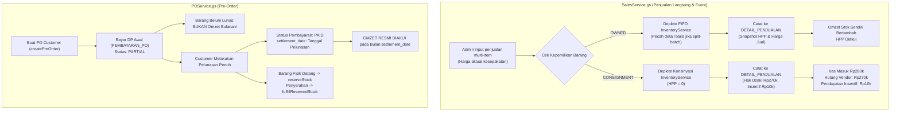

# LAPORAN IMPLEMENTASI PHASE 2C: SALES & PRE-ORDER TRANSACTION ENGINE
**Sistem Operasional, Multi-Vendor, Inventaris & Keuangan CrocsCircle.ID**

**Tanggal Implementasi:** 17 November 2026  
**Status Fase:** SELESAI & TERUJI (100% Passed)  
**Target Berikutnya:** Phase 2D (Vendor Management & Settlement Engine) setelah persetujuan Owner

---

## 1. PENDAHULUAN & ARSITEKTUR TRANSACTION ENGINE

Phase 2C menghubungkan aktivitas penjualan riil (offline bazar, mingguan, event, online) dan pemesanan Pre-Order (PO) dengan ketersediaan stok fisik dan pencatatan keuangan akurat.

Telah diimplementasikan dua modul backend utama:
- [`src/backend/SalesService.gs`](file:///D:/Documents/GitHub/CrocsCircle-Website/src/backend/SalesService.gs)
- [`src/backend/POService.gs`](file:///D:/Documents/GitHub/CrocsCircle-Website/src/backend/POService.gs)

Test runner & dokumentasi pengujian:
- [`tests/test_phase_2c.js`](file:///D:/Documents/GitHub/CrocsCircle-Website/tests/test_phase_2c.js)
- [`src/backend/TestAuthAndDatabase.gs`](file:///D:/Documents/GitHub/CrocsCircle-Website/src/backend/TestAuthAndDatabase.gs)



---

## 2. ATURAN PENJUALAN FLEKSIBEL & PEMISAHAN KONSINYASI

### A. Penjualan Stok Milik Sendiri (OWNED)
1. **Harga Tawar Aktual:** Admin memasukkan harga hasil kesepakatan dengan customer (misal katalog Rp280.000 ditawar menjadi Rp270.000). Nilai Rp270.000 tersimpan sebagai snapshot permanen di `DETAIL_PENJUALAN`.
2. **Integrasi FIFO:** Pemotongan stok memicu `InventoryService.depleteOwnedStockFIFO`. Jika pembelian berasal dari dua batch berbeda (misal 2 pasang dari Batch A @ modal Rp150.000 dan 2 pasang dari Batch B @ modal Rp160.000), transaksi otomatis dipecah menjadi 2 baris detail di `DETAIL_PENJUALAN`.
3. **Pengakuan Finansial:**
   - `owned_sales_amount = quantity * actual_price`
   - `total_hpp = sum(quantity * hpp_batch)`
   - `gross_profit = owned_sales_amount - total_hpp`

### B. Penjualan Barang Titipan Vendor (CONSIGNMENT)
1. **Tidak Ada HPP CrocsCircle:** `hpp_unit = 0` dan `total_hpp = 0`.
2. **Penerimaan Kas Bruto:** Customer membayar penuh ke CrocsCircle (misal Rp280.000).
3. **Pemisahan Hak & Kewajiban:**
   - `vendor_payable_unit = Rp270.000` (Masuk ke kewajiban/hutang vendor).
   - `crocs_incentive_unit = Rp10.000` (Masuk ke pendapatan insentif CrocsCircle).
   - `net_operational_revenue` CrocsCircle hanya bertambah Rp10.000, bukan Rp280.000.
   - Status pelunasan diset `settlement_status = 'UNPAID'` untuk dilunasi di Phase 2D.

---

## 3. ATURAN BAKU PRE-ORDER (PO) & PENGAKUAN OMZET

Sesuai ketentuan baku Master Prompt yang telah diuji:

| Kondisi Pembayaran PO | Status Pembayaran | Tanggal Pelunasan (`settlement_date`) | Pengakuan Omzet Bulanan |
|---|---|---|---|
| Belum ada pembayaran | `UNPAID` | *(Kosong)* | **Rp0** (Bukan omzet) |
| Sudah bayar DP 50% | `PARTIAL` | *(Kosong)* | **Rp0** (Bukan omzet, DP adalah liabilitas/titipan) |
| Pelunasan penuh (100%) | `PAID` | Tanggal uang pelunasan diterima | **Diakui 100%** pada bulan `settlement_date` |

### Integrasi Stok PO:
1. Pembuatan PO **tidak memotong stok fisik**.
2. Saat barang fisik tiba dari supplier, status pengadaan diubah ke `RECEIVED`, dan stok di-booking via `InventoryService.reserveStock` (stok fisik tetap, `reserved_stock` bertambah, `available_stock` berkurang).
3. Saat barang diserahkan ke customer, dijalankan `InventoryService.fulfillReservedStock` (`physical_stock` dan `reserved_stock` berkurang bersamaan) dan status fulfillment menjadi `DELIVERED`.
4. Jika PO dibatalkan, reservasi otomatis dilepaskan via `InventoryService.releaseReservation`.

---

## 4. PENANGANAN RETUR & PEMBATALAN

### A. Retur Item Penjualan OWNED
- Kuantitas yang diretur dikembalikan secara presisi ke `remaining_qty` pada batch pembelian asal di `DETAIL_PEMBELIAN`.
- Stok fisik bertambah kembali.

### B. Retur Item Penjualan CONSIGNMENT
- Stok fisik titipan vendor bertambah kembali di `consignment_physical_stock`.
- Jika kewajiban vendor statusnya `UNPAID`: Nilai hutang ke vendor otomatis dipotong/dibatalkan (`settlement_status = 'CANCELLED'`).
- Jika hak vendor sudah terlanjur ditransfer: Sistem mencatat klaim piutang vendor (`VENDOR_RECEIVABLE_CLAIM`) yang akan memotong transfer settlement berikutnya.

---

## 5. HASIL PENGUJIAN OTOMATIS (PHASE 2C TEST SUITE)

Pengujian dieksekusi menggunakan test runner [`tests/test_phase_2c.js`](file:///D:/Documents/GitHub/CrocsCircle-Website/tests/test_phase_2c.js) pada runtime Node.js v24.11.0.

### Log Hasil Eksekusi Nyata:
```text
=== MEMULAI PENGUJIAN OTOMATIS PHASE 2C (SALES & PRE-ORDER) ===

[PASS] 1, 3, & 7. Penjualan 1 Produk OWNED, Harga Negosiasi (Rp270k vs Katalog Rp280k) & Pembayaran QRIS
[PASS] 2 & 4. Penjualan Multi-Produk & Split-Batch FIFO
[PASS] 5 & 6. Penjualan CONSIGNMENT (Barang Dzaki), Hak Vendor Rp270k & Insentif Rp10k (HPP = 0)
[PASS] 8, 9, & 10. PO Multi-Item, DP, Pelunasan, & Pengakuan Omzet Baku (Hanya Saat Lunas)
[PASS] 11. Reservasi dan Fulfillment PO (Deduct Physical & Reserved Serentak)
[PASS] 12. Pembatalan PO dan Pelepasan Reservasi Otomatis
[PASS] 13. Retur Item Penjualan OWNED (Kembali ke Batch Asal)
[PASS] 14. Retur Item Penjualan CONSIGNMENT (Pembalikan Hutang Vendor)
[PASS] 15. Idempotency Penjualan (Pencegahan Transaksi Ganda)
[PASS] 16. Simulasi Kegagalan & Atomic Rollback Transaksi Multi-Item

=== HASIL REKAPITULASI PENGUJIAN PHASE 2C ===
Total Pengujian : 10 Grup Uji (Mencakup 16 Kriteria Wajib)
Berhasil        : 10
Gagal           : 0

SEMUA PENGUJIAN PHASE 2C BERHASIL 100%!
```

### Rincian Verifikasi 16 Kriteria Wajib:
1. **Penjualan 1 Produk OWNED:** Berhasil mencatat penjualan 1 pasang seharga Rp270.000 dengan HPP Rp150.000 dan laba kotor Rp120.000.
2. **Penjualan Multi-Produk:** Satu transaksi berhasil menampung 4 pasang Classic dan 1 pasang Loopy secara serentak.
3. **Harga Negosiasi:** Terbukti snapshot harga tawar Rp270.000 tersimpan di baris detail dan omzet dihitung dari harga tawar, bukan katalog.
4. **Split-Batch FIFO:** Pembelian 4 pasang saat Batch A sisa 2 (@ 150k) dan Batch B sisa 5 (@ 160k) otomatis dipecah menjadi 2 baris detail (2 pasang @ 150k + 2 pasang @ 160k).
5. & 6. **Penjualan Konsinyasi:** Penjualan 2 pasang barang Dzaki seharga Rp560.000 menghasilkan HPP Rp0, omzet stok sendiri Rp0, hak Dzaki Rp540.000, dan pendapatan insentif CrocsCircle Rp20.000.
7. **Pembayaran Customer:** Metode pembayaran QRIS, CASH, dan TRANSFER tersimpan di header transaksi.
8. & 9. **PO Multi-Item & Pembayaran Bertahap:** PO 2 item dibuat untuk Bu Ira dengan DP 50% tersimpan di `PEMBAYARAN_PO`.
10. **Pengakuan Omzet Baku:** Terbukti PO berstatus `PARTIAL` tidak dihitung sebagai omzet bulanan. Saat pelunasan 15 November, status menjadi `PAID` dan omzet diakui penuh pada bulan November.
11. **Reservasi & Fulfillment PO:** Booking stok berhasil menambah `reserved_stock`; penyerahan berhasil memotong stok fisik dan reservasi bersamaan.
12. **Pembatalan PO:** Pembatalan PO berhasil melepaskan reservasi stok kembali ke status siap jual.
13. **Retur OWNED:** Retur berhasil mengembalikan `remaining_qty` ke Batch A asal dan menambah stok fisik.
14. **Retur CONSIGNMENT:** Retur berhasil menambah stok konsinyasi dan memotong kewajiban hutang ke Dzaki sebesar Rp270.000.
15. **Idempotency:** Request berulang dengan `idempotency_key` yang sama mengembalikan transaksi eksisting tanpa memotong stok lagi.
16. **Atomic Rollback:** Transaksi yang memuat item overselling di baris kedua otomatis membatalkan item pertama yang sempat teralokasi, tanpa meninggalkan data setengah jadi.

---

## 6. STATUS KESIAPAN MENUJU PHASE 2D

Seluruh alur transaksi penjualan langsung dan pre-order telah tuntas, terintegrasi dengan modul inventaris & autentikasi, serta teruji 100%.

Sesuai urutan pengerjaan bertahap:
- [x] **Phase 1: Project Audit & Database Design**
- [x] **Phase 2A: Database & Authentication Engine**
- [x] **Phase 2B: Inventory & FIFO Engine**
- [x] **Phase 2C: Transaction Engine (Sales & Pre-Order)**
- [ ] **Phase 2D: Vendor Management & Settlement Engine**
  - `VendorService.gs`: Manajemen master vendor, monitoring kewajiban vendor belum disetor (*Restricted Cash*), eksekusi settlement pelunasan vendor gabungan & bertahap via tabel `SETTLEMENT_VENDOR` dan `DETAIL_SETTLEMENT_VENDOR`, serta penanganan bukti transfer/receipt.

Mohon konfirmasi Owner untuk laporan Phase 2C ini agar kita dapat melanjutkan ke **Phase 2D**.
<artifacts>
[PHASE_2C_IMPLEMENTATION_REPORT.md](file:///D:/Documents/GitHub/CrocsCircle-Website/docs/audit/PHASE_2C_IMPLEMENTATION_REPORT.md)
</artifacts>