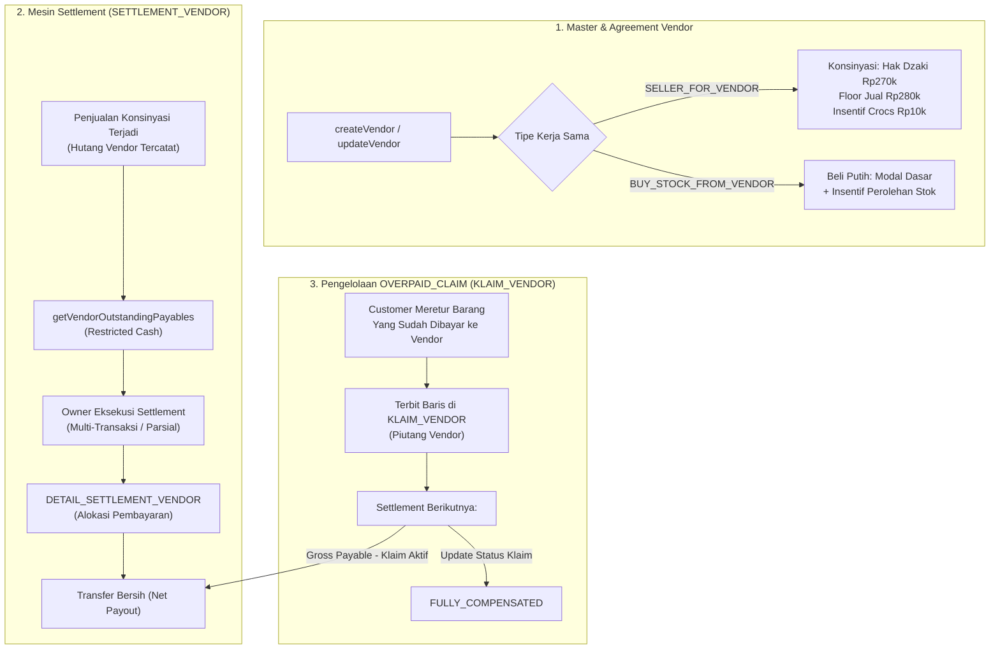

# LAPORAN IMPLEMENTASI PHASE 2D: VENDOR MANAGEMENT & SETTLEMENT ENGINE
**Sistem Operasional, Multi-Vendor, Inventaris & Keuangan CrocsCircle.ID**

**Tanggal Implementasi:** 17 November 2026  
**Status Fase:** SELESAI & TERUJI (100% Passed)  
**Target Berikutnya:** Phase 2E (Financial Management & Monthly Closing) setelah persetujuan Owner

---

## 1. PENDAHULUAN & ARSITEKTUR ENGINE

Phase 2D merealisasikan sistem manajemen vendor dan penyelesaian kewajiban finansial (*Vendor Settlement Engine*) dengan mematuhi prinsip utama bisnis:
> *"Uang customer, hak vendor, pendapatan CrocsCircle, HPP, dan laba CrocsCircle harus selalu bisa dibedakan dan ditelusuri."*

Telah diimplementasikan modul backend [`src/backend/VendorService.gs`](file:///D:/Documents/GitHub/CrocsCircle-Website/src/backend/VendorService.gs) dan tabel ledger piutang vendor [`KLAIM_VENDOR`](file:///D:/Documents/GitHub/CrocsCircle-Website/database/schema.json).



---

## 2. STRUKTUR TABEL & PERUBAHAN SKEMA BASIS DATA

Untuk mewadahi manajemen vendor, riwayat transfer, dan buku besar klaim piutang retur secara terpisah:

### A. Tabel Baru: `KLAIM_VENDOR` (Tabel 22)
Buku besar piutang khusus untuk melacak klaim pengembalian dana dari vendor akibat retur barang yang sudah terlanjur dibayarkan:
| Kolom | Tipe Data | Kunci | Keterangan |
|---|---|---|---|
| `claim_id` | STRING | PK | Contoh: `CLM-202611-0001` |
| `claim_date` | DATETIME | | Tanggal terjadinya retur/klaim |
| `vendor_id` | STRING | FK | Relasi ke `VENDORS.vendor_id` |
| `source_sales_detail_id`| STRING | FK | Relasi ke item penjualan yang diretur |
| `source_sales_id` | STRING | | ID transaksi penjualan asal |
| `claim_amount` | NUMBER | | Nominal klaim (contoh: Rp270.000) |
| `compensated_amount` | NUMBER | | Akumulasi nilai klaim yang telah dikompensasikan |
| `remaining_claim` | NUMBER | | Sisa piutang klaim yang belum dipotong |
| `claim_status` | ENUM | | `ACTIVE`, `PARTIALLY_COMPENSATED`, `FULLY_COMPENSATED` |
| `notes` | STRING | | Keterangan alasan retur & nomor transaksi |
| `created_by` | STRING | | User penanggung jawab |
| `created_at` | DATETIME | | Waktu record tersimpan |

### B. Penyempurnaan Tabel `SETTLEMENT_VENDOR` (Header Faktur Pelunasan)
- Ditambahkan kolom matematis eksplisit:
  - `total_gross_payable`: Total kewajiban kotor dari transaksi penjualan yang diselesaikan.
  - `total_claims_deducted`: Total potongan piutang klaim retur yang dikompensasikan.
  - `total_net_payout`: Nilai transfer bersih riil yang dikirim via bank ($\text{Gross} - \text{Klaim}$).

### C. Penyempurnaan Tabel `DETAIL_SETTLEMENT_VENDOR` (Alokasi Rincian)
- Ditambahkan kolom:
  - `allocation_type`: `PAYABLE_PAYMENT` (pembayaran kewajiban penjualan) atau `CLAIM_COMPENSATION` (pemotongan piutang klaim retur).
  - `sales_detail_id`: ID penjualan yang dilunasi.
  - `claim_id`: ID klaim piutang yang dikompensasikan.

### D. Penyempurnaan Tabel `VENDORS`
- Ditambahkan kolom: `address`, `cooperation_type` (`SELLER_FOR_VENDOR`, `BUY_STOCK_FROM_VENDOR`, `BOTH`), `fixed_vendor_share` (Rp270.000), `min_selling_price` (Rp280.000), dan `status` (`ACTIVE`/`INACTIVE`).

---

## 3. FUNGSI DAN BUSINESS LOGIC YANG DIIMPLEMENTASIKAN

Dalam [`src/backend/VendorService.gs`](file:///D:/Documents/GitHub/CrocsCircle-Website/src/backend/VendorService.gs):

1. **`createVendor`, `updateVendor`, `deactivateVendor`**:
   - Dilindungi `AuthService.requireOwner(callerToken)`.
   - Vendor yang memiliki transaksi tidak dapat dihapus permanen (*soft delete* ke status `INACTIVE`).
2. **`getVendorOutstandingPayables(vendorId)`**:
   - Menghitung akumulasi kewajiban penjualan konsinyasi yang belum disetor (*Restricted Cash*).
3. **`getVendorActiveClaims(vendorId)`**:
   - Mengambil seluruh saldo piutang retur yang berstatus `ACTIVE` atau `PARTIALLY_COMPENSATED` dari tabel `KLAIM_VENDOR`.
4. **`getVendorNetPayableSummary(vendorId)`**:
   - Menghasilkan ringkasan saldo bersih:
     $$\text{Net Payout Due} = \max(0, \text{Gross Payable} - \text{Active Claims})$$
5. **`executeSettlement(settlementData, callerToken)`**:
   - Wajib otorisasi Owner (`requireOwner`).
   - Mendukung pembayaran satu item, multi-item dalam 1 transfer bank, maupun pembayaran bertahap (parsial).
   - Mengompensasikan klaim piutang retur secara otomatis sehingga uang CrocsCircle tidak pernah hilang atau overpaid.
   - Mengunci transaksi via `LockService(30000)` anti-double settlement.
   - Mencegah pembayaran pada item yang sudah lunas (`PAID`) atau item yang sudah dibatalkan (`CANCELLED`).
   - Mencegah klaim dikompensasikan dua kali.
6. **`getVendorDashboardSummary(vendorId)`**:
   - Laporan konsolidasi vendor: total barang diterima, total terjual, sisa stok konsinyasi, total kotor, total terbayar, sisa hutang, dan daftar klaim aktif.

---

## 4. HASIL PENGUJIAN OTOMATIS (TEST SUITE PHASE 2D)

Pengujian dieksekusi menggunakan test runner [`tests/test_phase_2d.js`](file:///D:/Documents/GitHub/CrocsCircle-Website/tests/test_phase_2d.js) pada runtime Node.js v24.11.0:

```text
=== MEMULAI TEST SUITE PHASE 2D (VENDOR MANAGEMENT & SETTLEMENT) ===

[PASS] 1. Membuat Vendor Baru
[PASS] 2. Mengubah Data Vendor
[PASS] 3. Menonaktifkan Vendor (Status INACTIVE)
[PASS] 4 & 5. Perjanjian SELLER_FOR_VENDOR vs BUY_STOCK_FROM_VENDOR Terpisah
[PASS] 6 & 7. Konfigurasi Khusus Dzaki (Hak Rp270k, Floor Rp280k) vs Vendor Lain
[PASS] 8. Menghitung Kewajiban Vendor Konsinyasi Belum Disetor
[PASS] 9. Settlement Satu Transaksi (Pelunasan Tx 1 Rp270.000)
[PASS] 10 & 11. Settlement Parsial & Multi-Transaksi dalam 1 Transfer Bank
[PASS] 12. Pelunasan Penuh Sisa Hutang (410.000)
[PASS] 13. Mencegah Pembayaran Ganda (Item yang Sudah PAID Ditolak)
[PASS] 14. Mencegah Settlement Melebihi Kewajiban
[PASS] 15. Retur Sebelum Pembayaran (Kewajiban Langsung Dibatalkan)
[PASS] 16 & 18. Retur Setelah Lunas (Terbit Klaim di KLAIM_VENDOR) & Kompensasi Pada Settlement Berikutnya
[PASS] 17. Retur Setelah Pembayaran Parsial (Terbit Klaim Sebesar Yang Sudah Dibayar)
[PASS] 19. Mencegah Klaim Dikompensasikan Dua Kali
[PASS] 20. Audit Trail & Validasi Hak Akses Owner pada Eksekusi Settlement

=== HASIL REKAPITULASI PENGUJIAN PHASE 2D ===
Total Pengujian : 16 Grup Uji (Mencakup 20 Kriteria Wajib)
Berhasil        : 16
Gagal           : 0

SEMUA PENGUJIAN PHASE 2D BERHASIL 100%!
```

---

## 5. SKENARIO INTEGRASI: PEMBUKTIAN KOMPENSASI KLAIM RETUR

Berikut pembuktian matematis skenario Test 16 & 18 yang telah terverifikasi:

1. **Penjualan 1:** 1 pasang konsinyasi Dzaki terjual seharga Rp280.000 $\rightarrow$ Hutang Dzaki = Rp270.000.
2. **Settlement 1:** CrocsCircle mentransfer **Rp270.000** ke rekening Dzaki (Faktur lunas / `PAID`).
3. **Retur Customer:** Sepatu tersebut dikembalikan oleh pembeli karena cacat.
   - Stok fisik bertambah kembali.
   - Terbit baris piutang di `KLAIM_VENDOR` senilai **Rp270.000** berstatus `ACTIVE`.
4. **Penjualan 2:** Terjual 2 pasang baru milik Dzaki seharga Rp560.000 $\rightarrow$ Hutang kotor baru = **Rp540.000**.
5. **Settlement 2 (Kompensasi):**
   $$\begin{aligned}
   \text{Total Gross Payable} &= \text{Rp540.000} \\
   \text{Total Claims Deducted} &= \text{Rp270.000} \quad (\text{Memotong klaim retur Penjualan 1}) \\
   \mathbf{Total\ Net\ Payout} &= \mathbf{Rp270.000} \quad (\text{Hanya mentransfer Rp270.000 ke Dzaki})
   \end{aligned}$$
6. **Hasil Akhir:**
   - Dzaki menerima total transfer bersih Rp270.000 (sesuai hak riil 1 pasang yang benar-benar laku).
   - Uang CrocsCircle sebesar Rp270.000 yang sempat terlanjur dibayarkan telah **kembali 100%**.
   - Status klaim di `KLAIM_VENDOR` berubah menjadi `FULLY_COMPENSATED` dan **terkunci permanen (tidak dapat dipotong dua kali)**.

---

## 6. KESIAPAN MENUJU PHASE 2E

Seluruh layer transaksi, pengelolaan vendor, pelunasan hutang konsinyasi, dan ledger klaim retur telah selesai dan teruji tanpa celah.

Sesuai roadmap bertahap:
- [x] **Phase 1: Project Audit & Database Design**
- [x] **Phase 2A: Database & Authentication Engine**
- [x] **Phase 2B: Inventory & FIFO Engine**
- [x] **Phase 2C: Sales & Pre-Order Transaction Engine**
- [x] **Phase 2D: Vendor Management & Settlement Engine**
- [ ] **Phase 2E: Financial Management & Monthly Closing Engine**
  - `FinancialService.gs`: Perhitungan otomatis Omzet Stok Sendiri, Omzet PO Lunas (berdasarkan `settlement_date`), Pendapatan Insentif Vendor, Total HPP FIFO, Laba Kotor, Pengeluaran Operasional, Laba Bersih, dan Rekonsiliasi Saldo Kas (termasuk *Restricted Cash*).
  - `ClosingService.gs`: Simulasi tutup buku, snapshot penguncian periode (`CLOSED`), alokasi keuntungan resmi (Owner 1 20%, Owner 2 20%, Dana Darurat 10%, Keuntungan Ditahan 50%), akumulasi `SALDO_DANA`, serta prosedur pembukaan kembali periode (*Reopen Period*) dengan audit trail.

Mohon konfirmasi Owner untuk laporan Phase 2D ini agar kita dapat melanjutkan implementasi ke **Phase 2E**.
<artifacts>
[PHASE_2D_IMPLEMENTATION_REPORT.md](file:///D:/Documents/GitHub/CrocsCircle-Website/docs/audit/PHASE_2D_IMPLEMENTATION_REPORT.md)
</artifacts>