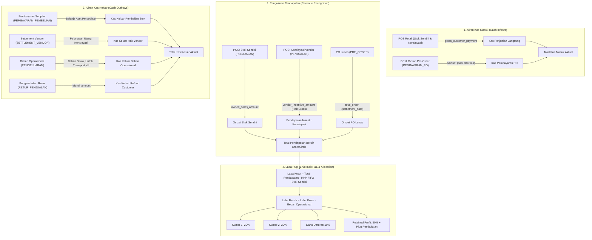
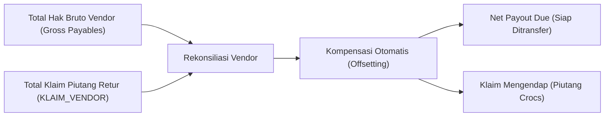
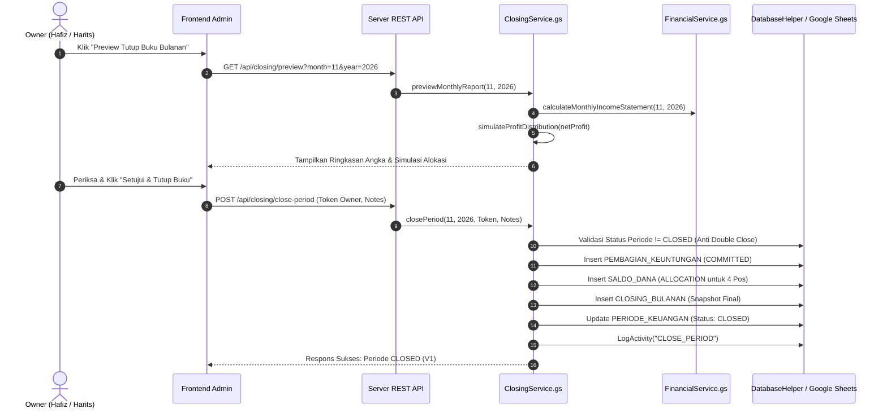
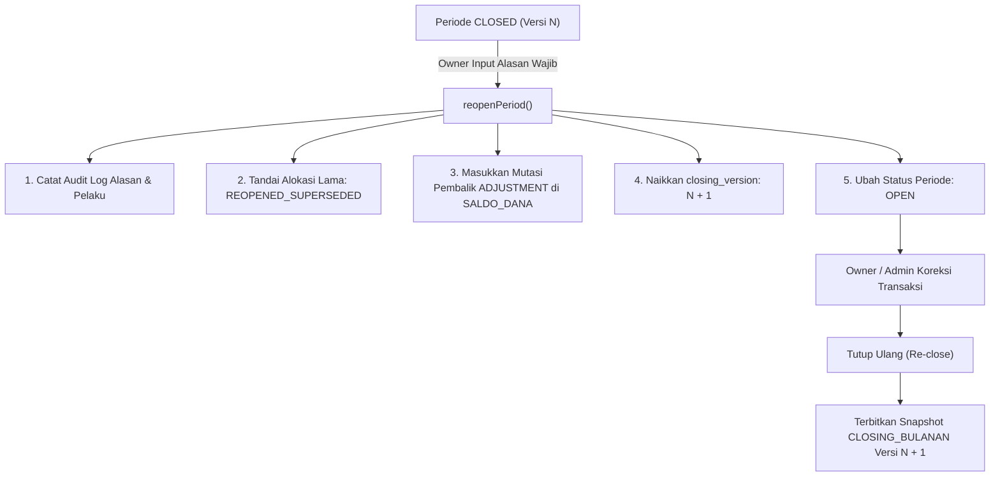

# BLUEPRINT AUDIT & RANCANGAN IMPLEMENTASI: PHASE 3D SUB-MODUL 4
**CrocsCircle.ID — Pelaporan Keuangan Komprehensif, Rekonsiliasi Kas, Rekonsiliasi Vendor, Month-End Closing & Prosedur Reopen**
*Dokumen Tanggal: 18 November 2026 | Status: AUDIT & BLUEPRINT ONLY (Zero Code Modification)*

---

## 1. Executive Summary

Berdasarkan mandat Owner, dokumen ini merupakan **Audit Mendalam dan Blueprint Arsitektural** untuk **Phase 3D Sub-Modul 4**. Tahap ini menyatukan seluruh aliran transaksi dari Sub-Modul 1 (POS & FIFO Retail), Sub-Modul 2 (Pre-Order & Pelunasan Bertahap), dan Sub-Modul 3 (Pembelian Stok, Logistik Fisik & Buku Kas Pembayaran Supplier) menjadi satu kesatuan pelaporan keuangan yang akurat, terverifikasi, dan dapat dipertanggungjawabkan (*audit-proof*).

### **Batasan Ketat Tahap Ini:**
- **HANYA AUDIT, ANALISIS, DAN PENYUSUNAN BLUEPRINT**: Tidak ada perubahan kode backend, frontend, skema database, data transaksi, maupun konfigurasi sistem pada langkah ini.
- **ZERO CODE MUTATION**: Seluruh sistem berjalan pada versi v1.2.0 tetap dibekukan hingga rancangan ini mendapatkan persetujuan tertulis dari Owner.

### **Kesimpulan Utama Audit Awal:**
1. **Fondasi Akuntansi Pokok Sudah Solid**: Pemisahan pendapatan stok sendiri vs insentif konsinyasi, pengakuan omzet PO saat lunas, dan isolasi beban operasional dari belanja modal telah diterapkan dengan benar di backend dasar (`FinancialService.gs` dan `SalesService.gs`).
2. **Tiga Kesenjangan Utama (Major Gaps) Teridentifikasi**:
   - **Kesenjangan Saldo Awal/Akhir Kas**: Sistem belum memiliki tabel/buku besar saldo awal kas dan mutasi kas menyeluruh untuk menghasilkan Laporan Arus Kas riil (hanya menghitung $\Delta \text{Net Cash Flow}$).
   - **Kesenjangan HPP Pre-Order**: Omzet PO diakui saat lunas, namun alokasi HPP untuk barang PO belum ditautkan ke snapshot laporan laba rugi.
   - **Keterbatasan Snapshot Closing**: Tabel `CLOSING_BULANAN` saat ini hanya menyimpan agregasi laba rugi makro, belum mengunci snapshot piutang/utang vendor, saldo kas akhir, dan posisi persediaan akhir bulan.

---

## 2. Daftar File dan Fungsi yang Diperiksa

Berikut adalah daftar modul dan fungsi yang telah diaudit secara teliti baris demi baris:

| No | File Sumber | Fungsi Utama yang Diperiksa | Cakupan & Peran |
| :---: | :--- | :--- | :--- |
| 1 | [`src/backend/FinancialService.gs`](file:///d:/Documents/GitHub/CrocsCircle-Website/src/backend/FinancialService.gs) | `calculateMonthlyIncomeStatement`<br>`getMonthlyCashAndVendorReconciliation`<br>`recordOperationalExpense`<br>`getExpensesList` | Kalkulasi omzet, HPP FIFO, laba kotor, beban operasional, laba bersih, filter kategori terlarang, dan komparasi kas vs akuntansi. |
| 2 | [`src/backend/ClosingService.gs`](file:///d:/Documents/GitHub/CrocsCircle-Website/src/backend/ClosingService.gs) | `simulateProfitDistribution`<br>`previewMonthlyReport`<br>`closePeriod`<br>`reopenPeriod`<br>`assertPeriodOpenForTransaction`<br>`getFundBalances`<br>`recordFundWithdrawal` | Simulasi alokasi laba 20:20:10:50, pembulatan plug, snapshot closing, pembatalan alokasi saat reopen, pemantauan defisit penarikan owner, dan proteksi periode CLOSED. |
| 3 | [`src/backend/InventoryService.gs`](file:///d:/Documents/GitHub/CrocsCircle-Website/src/backend/InventoryService.gs) | `depleteOwnedStockFIFO`<br>`depleteConsignmentStock`<br>`fulfillReservedStock`<br>`createPurchaseInvoice`<br>`receivePurchaseShipment`<br>`recordPurchasePayment`<br>`getPurchasesList` | Penurunan stok FIFO, insentif vendor, alokasi reservasi PO, pencatatan faktur & pembayaran supplier bertahap, dan pemisahan logistik fisik. |
| 4 | [`src/backend/SalesService.gs`](file:///d:/Documents/GitHub/CrocsCircle-Website/src/backend/SalesService.gs) | `recordSalesTransaction`<br>`getSalesList`<br>`processSalesReturn` | Pembentukan baris `PENJUALAN` & `DETAIL_PENJUALAN`, pemisahan `owned_sales_amount` vs `vendor_incentive_amount`, dan masking RBAC Admin. |
| 5 | [`src/backend/POService.gs`](file:///d:/Documents/GitHub/CrocsCircle-Website/src/backend/POService.gs) | `createPreOrder`<br>`recordPayment`<br>`getRecognizedMonthlyPO`<br>`fulfillPO`<br>`cancelPO` | Pengakuan omzet PO saat lunas (`settlement_date`), pemisahan DP/cicilan, dan pelepasan reservasi stok. |
| 6 | [`src/backend/VendorService.gs`](file:///d:/Documents/GitHub/CrocsCircle-Website/src/backend/VendorService.gs) | `getVendorOutstandingPayables`<br>`getVendorActiveClaims`<br>`getVendorNetPayableSummary`<br>`executeSettlement` | Perhitungan hak bersih vendor, kompensasi klaim retur otomatis, dan eksekusi settlement tanpa sentuh beban operasional. |
| 7 | [`src/backend/DatabaseHelper.gs`](file:///d:/Documents/GitHub/CrocsCircle-Website/src/backend/DatabaseHelper.gs) | `getAllRows`<br>`getRowByPk`<br>`insertRow`<br>`updateRowByPk`<br>`withLock`<br>`logActivity` | Abstraksi akses database, concurrency lock (LockService 30s), dan audit logging. |
| 8 | [`src/backend/InitDatabase.gs`](file:///d:/Documents/GitHub/CrocsCircle-Website/src/backend/InitDatabase.gs) | `CROCS_SCHEMA_V120`<br>`initializeCrocsCircleDatabase` | Skema 22 tabel resmi, inisialisasi tabel, dan default seeders. |
| 9 | [`server.js`](file:///d:/Documents/GitHub/CrocsCircle-Website/server.js) | Endpoint router API | Pemeriksaan ketersediaan endpoint finansial, proteksi session token, dan RBAC Owner vs Admin. |
| 10 | [`src/frontend/admin.html`](file:///d:/Documents/GitHub/CrocsCircle-Website/src/frontend/admin.html) | UI Dashboard & Navigation | Pemeriksaan sidebar, KPI cards, masking kolom finansial Admin, dan placeholder menu laporan keuangan. |

---

## 3. Pemetaan Sumber Data & Aliran Transaksi

Diagram berikut memetakan bagaimana seluruh transaksi operasional mengalir ke Laporan Keuangan, Arus Kas, dan Rekonsiliasi:



---

## 4. Kondisi Implementasi Aktual (Status Matrix)

Berdasarkan audit mendalam kode sumber saat ini, berikut adalah matriks status implementasi fitur:

| Komponen Fungsional | Status Saat Ini | Lokasi Kode | Keterangan & Catatan Teknis |
| :--- | :---: | :--- | :--- |
| **Omzet Stok Sendiri** | **SUDAH** | `FinancialService.gs:69-90` | Diambil dari `PENJUALAN.owned_sales_amount`. |
| **Pendapatan Konsinyasi** | **SUDAH** | `FinancialService.gs:71, 118` | Diambil dari `PENJUALAN.vendor_incentive_amount` (HPP = Rp0). |
| **Omzet PO Saat Lunas** | **SUDAH** | `FinancialService.gs:121-127`<br>`POService.gs:611-636` | Hanya PO berstatus `PAID` pada `settlement_date` bulan bersangkutan. |
| **HPP FIFO Penjualan POS** | **SUDAH** | `FinancialService.gs:86, 137` | Snapshot FIFO per transaksi dari `PENJUALAN.total_hpp`. |
| **HPP Pre-Order Terpenuhi** | **BELUM** | `POService.gs:325-347` | PO lunas belum mencatat/menautkan snapshot HPP barang yang diserahkan. |
| **Isolasi Beban Operasional** | **SUDAH** | `FinancialService.gs:35-45, 161-171` | Filter `NON_OPERATIONAL_CATEGORIES` aktif menolak belanja modal/vendor. |
| **Alokasi Laba (20:20:10:50)** | **SUDAH** | `ClosingService.gs:69-131` | Plug pembulatan otomatis ke Retained Profit, alokasi 0 jika laba $\le 0$. |
| **Kas Keluar Supplier** | **SUDAH** | `FinancialService.gs:301-327` | Terintegrasi dengan buku besar `PEMBAYARAN_PEMBELIAN`. |
| **Kas Keluar Hak Vendor** | **SUDAH** | `FinancialService.gs:276-289` | Mengambil `total_net_payout` dari `SETTLEMENT_VENDOR`. |
| **Saldo Awal & Akhir Kas** | **BELUM** | `FinancialService.gs:344-361` | Baru menghitung arus kas bersih ($\Delta$), belum ada buku saldo awal kas. |
| **Rekonsiliasi Vendor** | **SEBAGIAN** | `VendorService.gs:122-184` | Sudah ada di backend, belum tersedia halaman/laporan rekapitulasi Owner. |
| **Month-End Closing Execution**| **SUDAH (Backend)** | `ClosingService.gs:159-298` | Idempoten, menyimpan snapshot ringkas di `CLOSING_BULANAN`. |
| **Prosedur Reopen Period** | **SUDAH (Backend)** | `ClosingService.gs:304-381` | Mewajibkan alasan, menaikkan versi, membalik alokasi `SALDO_DANA`. |
| **Snapshot Komprehensif** | **BELUM** | `ClosingService.gs:249-266` | Snapshot belum menyimpan posisi piutang, utang vendor, dan valuasi stok. |
| **Endpoint REST API Laporan** | **BELUM** | `server.js` | Endpoint `/api/reports/income-statement`, `/api/closing/*` belum dibuka. |
| **Frontend UI Laporan & Closing**| **BELUM** | `src/frontend/admin.html:56` | Masih berstatus placeholder `showPlaceholder()`. |

---

## 5. Temuan Bug & Risiko Arsitektural

Berikut adalah temuan teknis mendalam hasil penelusuran kode yang berpotensi menimbulkan inkonsistensi jika tidak ditangani pada Sub-Modul 4:

### Temuan 1: Ketiadaan Pelacakan HPP pada Pemenuhan Pre-Order
- **Lokasi Kode**: [`src/backend/POService.gs:325-347`](file:///d:/Documents/GitHub/CrocsCircle-Website/src/backend/POService.gs#L325-L347) dan [`src/backend/FinancialService.gs:134-138`](file:///d:/Documents/GitHub/CrocsCircle-Website/src/backend/FinancialService.gs#L134-L138).
- **Kondisi Aktual**: Ketika PO lunas (`PAID`), omzet diakui sebesar `total_order`. Namun saat barang diserahkan via `fulfillPO()`, pemotongan stok fisik di `InventoryService.fulfillReservedStock()` tidak mencatat biaya perolehan (HPP) ke tabel `PRE_ORDER` maupun `PENJUALAN`. Akibatnya, pada `calculateMonthlyIncomeStatement()`, omzet PO diakui 100% tanpa pengurang HPP, sehingga Laba Kotor dan Laba Bersih terdistorsi lebih tinggi (*overstated gross margin*).
- **Rekomendasi Solusi**: Pada Sub-Modul 4, tambahkan mekanisme pengakuan HPP PO saat fulfillment atau saat pelunasan berdasarkan HPP batch alokasi stok.

### Temuan 2: Laporan Arus Kas Belum Memiliki Saldo Awal Kas (*Beginning Balance*)
- **Lokasi Kode**: [`src/backend/FinancialService.gs:343-361`](file:///d:/Documents/GitHub/CrocsCircle-Website/src/backend/FinancialService.gs#L343-L361).
- **Kondisi Aktual**: Fungsi `getMonthlyCashAndVendorReconciliation()` hanya menghitung:
  $$\text{Net Cash Flow} = \text{Total Cash Inflow} - \text{Total Cash Outflow}$$
  Fungsi ini belum menghubungkan saldo awal kas dari penutupan buku bulan sebelumnya. Jika Owner ingin melihat "Berapa uang kas riil di rekening bank/kasir saat ini?", sistem belum bisa menjawab karena tidak ada tabel saldo kas rekening operasional.
- **Rekomendasi Solusi**: Perlu ditambahkan struktur pelacakan saldo awal kas periode dan saldo akhir rekonsiliasi kas.

### Temuan 3: Snapshot Closing Bulanan Terlalu Minimalis
- **Lokasi Kode**: [`src/backend/ClosingService.gs:249-266`](file:///d:/Documents/GitHub/CrocsCircle-Website/src/backend/ClosingService.gs#L249-L266) dan tabel `CLOSING_BULANAN`.
- **Kondisi Aktual**: Kolom `CLOSING_BULANAN` hanya menyimpan: `total_omzet, total_hpp, gross_profit, operational_expenses, net_profit, owner1_amount, owner2_amount, emergency_amount, retained_amount`.
  Snapshot ini **tidak** menyimpan:
  - Posisi sisa utang vendor konsinyasi pada akhir bulan tersebut.
  - Nilai persediaan akhir (*ending inventory valuation*).
  - Rincian penerimaan kas dan pengeluaran kas.
  Jika terjadi transaksi di bulan berikutnya, laporan historis bulan yang ditutup tidak memiliki snapshot posisi neraca kas/kewajiban.
- **Rekomendasi Solusi**: Simpan payload JSON detail rekonsiliasi kas dan posisi kewajiban vendor ke dalam kolom snapshot `closing_payload_json` atau kolom pelengkap pada `CLOSING_BULANAN`.

---

## 6. Ketidaksesuaian terhadap Aturan Bisnis & Rekomendasi Resolusi

Berikut adalah evaluasi terhadap aturan bisnis wajib CrocsCircle:

| Aturan Bisnis Owner | Implementasi Aktual | Analisis Kepatuhan & Mitigasi |
| :--- | :--- | :--- |
| **1. Konsinyasi: Omzet Crocs = Insentif, HPP = Rp0** | `SalesService.gs` memisahkan `owned_sales_amount` dan `vendor_incentive_amount`. `FinancialService.gs` hanya memasukkan insentif ke omzet. | **PATUH 100%**. Transaksi Dzaki (Jual 280k, Hak Dzaki 270k) tercatat: Omzet Crocs = Rp10.000, HPP = Rp0, Kas Masuk = Rp280.000, Utang Vendor = Rp270.000. |
| **2. Pengakuan Omzet PO Saat Lunas** | `POService.getRecognizedMonthlyPO` hanya menarik PO berstatus `PAID` pada `settlement_date` bulan bersangkutan. DP tidak masuk omzet. | **PATUH 100%**. Teruji pada pengujian Sub-Modul 2. |
| **3. Pembelian Stok Bukan Beban Operasional** | `FinancialService.recordOperationalExpense` menolak kategori `STOCK_PURCHASE` / `PEMBELIAN_STOK`. | **PATUH 100%**. Belanja stok tercatat sebagai arus kas keluar aset, bukan beban P&L. |
| **4. Alokasi Laba 20:20:10:50 dengan Plug Retained** | `ClosingService.simulateProfitDistribution` membagi laba bersih positif dan menempatkan selisih pembulatan ke Retained Profit. Alokasi bernilai 0 jika laba $\le 0$. | **PATUH 100%**. Teruji pada pengujian Phase 3B/3C. |
| **5. Reopen Tidak Boleh Menghapus Snapshot Lama** | `ClosingService.reopenPeriod` menaikkan `closing_version`, membalik alokasi di `SALDO_DANA`, dan tidak menghapus baris `CLOSING_BULANAN`. | **PATUH 95%**. Perlu penyempurnaan penanganan audit trail jika Owner telah melakukan penarikan kas (*withdrawal*) melebihi alokasi versi baru. |

---

## 7. Rancangan Laporan Laba Rugi Bulanan (Income Statement)

Laporan laba rugi menyajikan kinerja operasional murni (akrual):

### **Struktur Standar Laporan Laba Rugi CrocsCircle.ID:**
```text
========================================================================================
LAPORAN LABA RUGI BULANAN (INCOME STATEMENT) — PERIODE: [BULAN TAHUN]
========================================================================================
1. PENDAPATAN OPERASIONAL BERSIH (REVENUE)
   a. Omzet Penjualan Stok Sendiri (Bruto)         : Rp  xxx.xxx.xxx
      - Retur Penjualan Stok Sendiri               : (Rp  xx.xxx.xxx)
      --------------------------------------------------------------
      Subtotal Omzet Penjualan Stok Sendiri        : Rp  xxx.xxx.xxx
   b. Pendapatan Insentif Konsinyasi Vendor        : Rp   xx.xxx.xxx
      - Penyesuaian Retur Insentif Konsinyasi      : (Rp   x.xxx.xxx)
      --------------------------------------------------------------
      Subtotal Pendapatan Insentif Konsinyasi      : Rp   xx.xxx.xxx
   c. Omzet Pre-Order yang Telah Lunas             : Rp   xx.xxx.xxx
   -----------------------------------------------------------------
   TOTAL PENDAPATAN CROCSCIRCLE                    : Rp  XXX.XXX.XXX

2. HARGA POKOK PENJUALAN (HPP / COGS)
   a. HPP FIFO Penjualan Stok Sendiri Terjual      : Rp  xxx.xxx.xxx
      - Pemulihan HPP atas Retur Stok Masuk Gudang : (Rp  xx.xxx.xxx)
   b. HPP Pemenuhan Pre-Order (FIFO / Biaya Beli)  : Rp   xx.xxx.xxx
   c. HPP Barang Konsinyasi Vendor                 : Rp            0  (HPP Konsinyasi Selalu Rp0)
   -----------------------------------------------------------------
   TOTAL HARGA POKOK PENJUALAN                     : Rp  XXX.XXX.XXX

3. LABA KOTOR (GROSS PROFIT = PENDAPATAN - HPP)    : Rp  XXX.XXX.XXX

4. BEBAN OPERASIONAL (OPERATIONAL EXPENSES)
   - Beban Sewa Tempat & Gudang                    : Rp   xx.xxx.xxx
   - Beban Listrik, Internet & Utilitas            : Rp    x.xxx.xxx
   - Beban Kemasan / Packaging & Lakban            : Rp    x.xxx.xxx
   - Beban Transportasi & Pengiriman Lokal         : Rp    x.xxx.xxx
   - Beban Pemasaran & Iklan                       : Rp    x.xxx.xxx
   - Beban Operasional Lainnya                     : Rp    x.xxx.xxx
   -----------------------------------------------------------------
   TOTAL BEBAN OPERASIONAL                         : Rp   XX.XXX.XXX

5. LABA BERSIH OPERASIONAL (NET PROFIT)            : Rp  XXX.XXX.XXX
========================================================================================
SIMULASI / ALOKASI PEMBAGIAN KEUNTUNGAN (PROFIT DISTRIBUTION):
- Owner 1 (Hafiz)         : 20%                   : Rp   xx.xxx.xxx
- Owner 2 (Harits)        : 20%                   : Rp   xx.xxx.xxx
- Dana Darurat Operasional: 10%                   : Rp   xx.xxx.xxx
- Keuntungan Ditahan      : 50% (+ Plug Pembulatan): Rp   xx.xxx.xxx
----------------------------------------------------------------------------------------
TOTAL ALOKASI (Tepat 100% Laba Bersih)             : Rp  XXX.XXX.XXX
========================================================================================
```

---

## 8. Rancangan Laporan Arus Kas (Cash Flow Statement)

Laporan Arus Kas menjawab secara riil perpindahan uang fisik di rekening bank dan kasir tanpa bercampur dengan konsep akrual omzet:

### **Struktur Laporan Arus Kas Komprehensif:**
```text
========================================================================================
LAPORAN ARUS KAS BULANAN (CASH FLOW STATEMENT) — PERIODE: [BULAN TAHUN]
========================================================================================
SALDO AWAL KAS & BANK (BEGINNING CASH BALANCE)     : Rp  XXX.XXX.XXX

1. ARUS KAS MASUK (CASH INFLOWS)
   a. Penerimaan Kas Pelanggan POS Retail          : Rp  xxx.xxx.xxx
      (Termasuk uang bruto titip jual vendor)
   b. Penerimaan Kas Down Payment (DP) Pre-Order   : Rp   xx.xxx.xxx
   c. Penerimaan Kas Pelunasan Pre-Order           : Rp   xx.xxx.xxx
   d. Penerimaan Kas Lain-Lain (Injeksi Modal, dll): Rp            0
   -----------------------------------------------------------------
   TOTAL ARUS KAS MASUK                            : Rp  XXX.XXX.XXX

2. ARUS KAS KELUAR (CASH OUTFLOWS)
   a. Pembayaran Faktur Supplier (Persediaan)      : Rp  xxx.xxx.xxx
      (Berdasarkan tabel PEMBAYARAN_PEMBELIAN)
   b. Pembayaran Pelunasan Hak Vendor Konsinyasi   : Rp   xx.xxx.xxx
      (Berdasarkan tabel SETTLEMENT_VENDOR)
   c. Pembayaran Beban Operasional                 : Rp   xx.xxx.xxx
      (Berdasarkan tabel PENGELUARAN kategori valid)
   d. Pengembalian Kas Refund Customer (Retur/Batal):Rp    x.xxx.xxx
   e. Penarikan Kas Pribadi Owner (Withdrawal)     : Rp   xx.xxx.xxx
      (Berdasarkan tabel SALDO_DANA tipe WITHDRAWAL)
   -----------------------------------------------------------------
   TOTAL ARUS KAS KELUAR                           : Rp  XXX.XXX.XXX

3. ARUS KAS BERSIH BULAN BERJALAN (NET CASH FLOW)  : Rp   XX.XXX.XXX
   (Total Arus Kas Masuk - Total Arus Kas Keluar)

4. SALDO AKHIR KAS & BANK (ENDING CASH BALANCE)    : Rp  XXX.XXX.XXX
   (Saldo Awal + Net Cash Flow)
========================================================================================
REKONSILIASI AKUNTANSI VS SALDO KAS RIIL:
- Saldo Kas Akhir                                  : Rp  xxx.xxx.xxx
- Kewajiban Vendor Belum Disetor (Restricted Cash) : (Rp  xx.xxx.xxx)
- Uang Muka DP Pre-Order Mengendap (Kewajiban PO)  : (Rp  xx.xxx.xxx)
----------------------------------------------------------------------------------------
KAS BEBAS CROCSCIRCLE (UNRESTRICTED OPERATING CASH): Rp  XXX.XXX.XXX
========================================================================================
```

---

## 9. Rancangan Rekonsiliasi Vendor

Rekonsiliasi vendor memantau secara presisi hak mitra konsinyasi dan memastikan tidak ada uang vendor yang terpakai untuk pembagian dividen Owner:



### **Tabel Rekonsiliasi per Vendor:**
1. **Total Hak Kotor Terakumulasi**: Jumlah `total_vendor_payable` dari penjualan barang konsinyasi vendor yang bersangkutan.
2. **Klaim Retur Terpotong**: Nilai kompensasi pemotongan klaim atas barang cacat/batal retur yang disepakati.
3. **Total Kas yang Sudah Ditransfer**: Agregasi `total_net_payout` dari `SETTLEMENT_VENDOR`.
4. **Sisa Kewajiban Bersih (Outstanding Liability)**: Saldo utang riil yang wajib disediakan dalam kas (*Restricted Cash*).
5. **Riwayat Settlement**: Daftar nomor referensi bank, bukti transfer, dan tanggal transfer per termin.

---

## 10. Rancangan Month-End Closing Engine

Proses tutup buku bulanan dirancang dengan 10 langkah berurutan (*step-by-step sequential workflow*) yang dilindungi oleh `DatabaseHelper.withLock`:



### **Prinsip Penting Closing:**
1. **Idempotent**: Eksekusi berulang dengan versi dan parameter yang sama tidak akan menduplikasi baris snapshot.
2. **Value Snapshot (Bukan Pointer)**: Angka omzet, HPP, beban operasional, laba bersih, dan alokasi disimpan berupa nilai nominal pasti pada saat tombol ditekan.
3. **Lockdown Transaksi**: Begitu status `CLOSED`, seluruh fungsi pencatatan penjualan, pengeluaran, pembelian, dan pembayaran menolak tanggal transaksi yang berada di bulan tersebut.

---

## 11. Rancangan Prosedur Reopen & Audit Trail Multi-Versi

Prosedur Reopen diperlukan jika di kemudian hari ditemukan koreksi data penting yang hanya boleh dilakukan oleh Owner.



### **Ketentuan Penanganan Penarikan Dana (*Drawings*) saat Reopen:**
- Jika Owner telah melakukan penarikan kas fisik (`WITHDRAWAL`) berdasarkan alokasi Versi 1:
  - Penarikan fisik **tidak boleh dihapus** karena uang kas sudah keluar secara riil.
  - Saat alokasi Versi 1 dibalik dengan `ADJUSTMENT` negatif, saldo Owner di `SALDO_DANA` akan berkurang sebesar alokasi tersebut.
  - Jika alokasi Versi 2 menghasilkan laba yang lebih kecil dari jumlah penarikan yang telah diambil, saldo pos Owner akan bernilai **negatif (Defisit)**.
  - Sistem menandai defisit tersebut sebagai **Piutang Bisnis kepada Owner (*Owner Overdrawing Receivable*)** dan akan memotong alokasi laba di bulan-bulan berikutnya secara otomatis.

---

## 12. Analisis Komparatif Ongkir Supplier

Sesuai instruksi Owner, Antigravity **tidak mengambil keputusan sepihak**. Berikut analisis komparatif dua alternatif perlakuan akuntansi ongkir supplier:

| Kriteria Analisis | Alternatif 1: Beban Logistik Periode (*Freight-In Expense*) | Alternatif 2: Kapitalisasi Persediaan (*Capitalized Landed Cost*) |
| :--- | :--- | :--- |
| **Mekanisme Perhitungan** | Dicatat sebagai beban logistik pembelian pada P&L di bulan kas dibayarkan. HPP unit tetap $\text{base} + \text{incentive}$ (Rp210.000). | Ongkir dialokasikan merata per unit: $\text{HPP Unit} = 210.000 + (50.000 / 10) = \text{Rp215.000}$. |
| **Dampak terhadap HPP** | HPP unit per pasang lebih rendah (murni harga beli produk). | HPP unit per pasang lebih tinggi (+Rp5.000/pasang). |
| **Dampak Laba Kotor** | Laba kotor transaksi penjualan per pasang tampak lebih tinggi. | Laba kotor transaksi penjualan per pasang mencerminkan margin riil setelah ongkir. |
| **Dampak Laba Bersih** | Laba bersih bulan kedatangan barang tertekan langsung sebesar Rp50.000 penuh, meskipun barang belum laku terjual. | Laba bersih diakui proporsional hanya saat barang laku terjual (*Matching Principle* IFRS/SAK). |
| **Nilai Persediaan (Neraca)** | Nilai aset persediaan di neraca lebih rendah (hanya harga barang). | Nilai aset persediaan di neraca mencerminkan biaya perolehan penuh (*true inventory asset*). |
| **Dampak Arus Kas** | **Sama persis**: Uang kas keluar Rp50.000 saat pembayaran faktur supplier dilakukan. | **Sama persis**: Uang kas keluar Rp50.000 saat pembayaran faktur supplier dilakukan. |
| **Penanganan Penerimaan Bertahap** | **Sangat Sederhana**: Ongkir melekat pada faktur, tidak terpengaruh barang tiba 6 atau 4 pasang. | **Lebih Kompleks**: Perlu formula penangguhan alokasi ongkir jika penerimaan bertahap terpecah lintas bulan. |
| **Rekomendasi Teknis** | **Cocok untuk fase awal** kesederhanaan pembukuan UMKM. | **Standar akuntansi formal** untuk penilaian persediaan presisi. |

> [!IMPORTANT]
> **Status**: Menunggu keputusan resmi Owner (Hafiz / Harits) sebelum implementasi Sub-Modul 4 dimulai.

---

## 13. Rancangan Antarmuka Pengguna (UI) & Endpoint REST API

### A. Endpoint REST API Baru yang Akan Didaftarkan di `server.js`:
1. `GET /api/reports/income-statement?month=M&year=YYYY` (Role: Owner)
2. `GET /api/reports/cash-flow?month=M&year=YYYY` (Role: Owner)
3. `GET /api/reports/vendor-reconciliation?vendor_id=VND&month=M&year=YYYY` (Role: Owner)
4. `GET /api/closing/preview?month=M&year=YYYY` (Role: Owner)
5. `POST /api/closing/close-period` (Role: Owner, Body: `{ month, year, notes, custom_percentages }`)
6. `POST /api/closing/reopen-period` (Role: Owner, Body: `{ period_id, reason }`)
7. `GET /api/closing/fund-balances` (Role: Owner)
8. `POST /api/closing/fund-withdrawal` (Role: Owner, Body: `{ fund_type, amount, notes }`)

### B. Rancangan Tampilan Frontend (`src/frontend/admin.html`):
Menu **"Laporan Keuangan & Tutup Buku"** di sidebar admin akan diaktifkan dengan antarmuka modular:
- **Tab 1: Laporan Laba Rugi**: Kartu ringkasan Omzet Bersih, HPP, Laba Kotor, Beban Operasional, Laba Bersih, dan tombol cetak/ekspor.
- **Tab 2: Laporan Arus Kas**: Saldo Awal, Arus Kas Masuk, Arus Kas Keluar, Net Cash Flow, dan Saldo Akhir.
- **Tab 3: Rekonsiliasi Vendor**: Tabel ringkasan per vendor, saldo utang konsinyasi mengendap, klaim aktif, dan riwayat transfer.
- **Tab 4: Tutup Buku & Alokasi Dana**: Status periode (OPEN/CLOSED), versi penutupan, preview alokasi 4 pos dana, tombol "Tutup Buku", tombol "Buka Kembali (Reopen)", dan saldo riil 4 pos dana beserta form penarikan (*withdrawal*).

---

## 14. Rencana Perubahan Skema Basis Data (Jika Diperlukan)

Tabel-tabel pada skema `CROCS_SCHEMA_V120` sudah sangat lengkap (22 tabel). Namun, untuk mendukung audit trail penutupan buku komprehensif, disarankan penambahan kolom opsional non-breaking berikut:

1. **Tabel `CLOSING_BULANAN`**:
   - Menambahkan kolom `summary_payload_json` (Menyimpan snapshot lengkap struktur JSON laba rugi, kas masuk/keluar, dan posisi utang vendor pada detik closing).
2. **Tabel `PRE_ORDER`**:
   - Menambahkan kolom `allocated_hpp` (Mencatat snapshot HPP stok saat alokasi/fulfillment dilakukan).
3. **Tabel `PERIODE_KEUANGAN`**:
   - Menambahkan kolom `beginning_cash_balance` dan `ending_cash_balance` (Menghubungkan saldo awal dan saldo akhir kas antar periode).

*(Seluruh penambahan bersifat backward-compatible dan tidak merusak data yang telah ada).*

---

## 15. Matriks Test Case Komprehensif (20 Skenario Uji)

Berikut adalah 20 skenario uji yang dirancang untuk pengujian menyeluruh Sub-Modul 4:

| No | Skenario Pengujian | Hasil yang Diharapkan |
| :---: | :--- | :--- |
| 1 | Penjualan POS stok sendiri | Omzet = harga jual, HPP FIFO terpotong, Laba Kotor = Omzet - HPP. |
| 2 | Penjualan POS barang konsinyasi | Omzet = Insentif Crocs, HPP = Rp0, Utang Vendor bertambah, Laba Kotor = Insentif. |
| 3 | Pre-Order DP di Bulan 10, Lunas di Bulan 11 | Bulan 10: Omzet Rp0, Kas Masuk DP tercatat. Bulan 11: Omzet diakui penuh, Kas Masuk sisa tercatat. |
| 4 | Pembelian stok dengan pembayaran bertahap | Kas keluar tercatat bertahap dari `PEMBAYARAN_PEMBELIAN`, Beban Operasional Rp0. |
| 5 | Penerimaan stok bertahap (6 + 4) | Stok fisik bertambah sesuai penerimaan fisik, HPP baru diakui saat terjual. |
| 6 | Pengeluaran operasional valid | Masuk beban operasional P&L, mengurangi laba bersih dan kas keluar. |
| 7 | Pembayaran kewajiban vendor | Mengurangi saldo kas keluar, melunasi utang vendor, tidak masuk beban P&L. |
| 8 | Kompensasi klaim retur vendor | Mengurangi utang kotor vendor tanpa dobel potong, kas transfer = net payout. |
| 9 | Rekonsiliasi arus kas bulanan | $\text{Saldo Akhir} = \text{Saldo Awal} + \text{Kas Masuk} - \text{Kas Keluar}$. |
| 10 | Rekonsiliasi laba rugi vs arus kas | Memverifikasi perbedaan nyata antara Laba Bersih vs Kas Bersih. |
| 11 | Closing periode dengan laba positif | Alokasi tepat 20:20:10:50 dengan plug pembulatan ke Retained Profit. |
| 12 | Closing periode dengan laba nol atau rugi | Seluruh 4 pos alokasi bernilai Rp0, periode tetap dapat ditutup. |
| 13 | Percobaan closing ganda | Ditolak keras oleh sistem jika status periode sudah `CLOSED`. |
| 14 | Transaksi pada periode CLOSED | Ditolak keras oleh `ClosingService.assertPeriodOpenForTransaction`. |
| 15 | Reopen periode dengan alasan audit | Alasan tersimpan, versi naik (V2), mutasi alokasi dibalik di `SALDO_DANA`. |
| 16 | Reclosing setelah reopen | Snapshot V2 tersimpan, snapshot V1 tetap ada di riwayat database. |
| 17 | Reopen setelah penarikan kas Owner | Saldo pos Owner mencatat defisit jika alokasi baru lebih kecil dari penarikan. |
| 18 | Pencegahan alokasi & penarikan ganda | Idempotensi key dan validasi saldo mencegah duplikasi dana. |
| 19 | Proteksi RBAC Owner vs Admin | Admin tidak dapat melihat HPP, laba bersih, alokasi, saldo dana, dan closing. |
| 20 | Idempotency & Concurrency Lock | Operasi simultan tertangani aman tanpa *race conditions* melalui `LockService`. |

---

## 16. Urutan Implementasi yang Disarankan (Roadmap)

Jika blueprint ini disetujui Owner, implementasi Sub-Modul 4 disarankan mengikuti 5 tahap berurutan:

```text
Tahap 1: Penyempurnaan Engine Finansial & HPP PO (FinancialService.gs & POService.gs)
Tahap 2: Penyempurnaan Rekonsiliasi Kas & Rekonsiliasi Vendor (FinancialService.gs & VendorService.gs)
Tahap 3: Penyempurnaan Month-End Closing Snapshot & Reopen Audit Trail (ClosingService.gs)
Tahap 4: Registrasi Endpoint REST API Finansial & Middleware RBAC (server.js)
Tahap 5: Pembangunan Tampilan Antarmuka Frontend (src/frontend/admin.html & admin.js)
Tahap 6: Eksekusi 20 Test Case Khusus & Uji Regresi Menyeluruh (25+ Suite)
```

---

## 17. Daftar Keputusan Bisnis yang Memerlukan Persetujuan Owner

Sebelum implementasi kode dimulai, berikut 3 keputusan bisnis yang dimohonkan konfirmasi tertulis dari Owner:

1. **Keputusan Perlakuan Ongkir Supplier**:
   - Apakah ongkir supplier dicatat sebagai **Beban Logistik Periode (Alternatif 1)** atau **Dikapitalisasi Proporsional ke HPP Unit Persediaan (Alternatif 2)**?
2. **Mekanisme HPP Pre-Order**:
   - Apakah HPP barang PO diakui saat **pelunasan pesanan** atau saat **penyerahan fisik barang (fulfillment)**?
3. **Saldo Awal Kas Pertama Kali**:
   - Berapa saldo awal kas riil per 1 Oktober 2026 atau 1 November 2026 yang akan dijadikan basis perhitungan awal Laporan Arus Kas?

---
*Dokumen Blueprint ini selesai disusun untuk ditinjau oleh Owner CrocsCircle.ID. Antigravity tetap standby dan tidak melakukan perubahan kode apa pun.*
