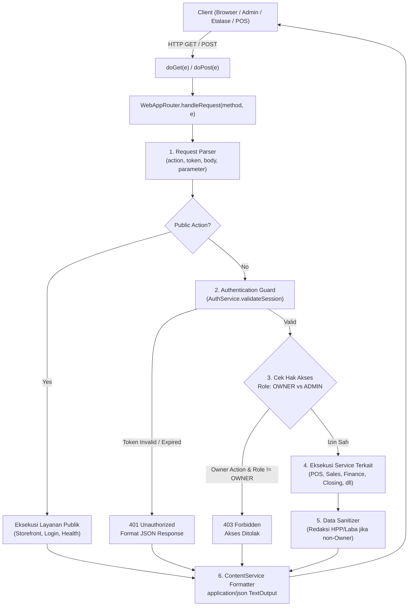

# LAPORAN IMPLEMENTASI PHASE 3E.1: GOOGLE APPS SCRIPT WEB APP ROUTER

**CrocsCircle.ID — Sistem Manajemen Finansial, Inventaris, dan Etalase Digital**  
**Tanggal:** 19 November 2026  
**Status:** **APPROVED & READY FOR PHASE 3E.2 REVIEW**  
**Cakupan:** Universal Web App Entry Point (`doGet` & `doPost`), Request Parsing, Role-Based Access Control (RBAC), Format Response `ContentService`, Data Sanitization, Error Handling, dan Test Suite Phase 3E.1.

---

## 1. Executive Summary

Phase 3E.1 adalah gerbang arsitektur utama yang menghubungkan seluruh modul backend CrocsCircle.ID (*AuthService*, *ProductService*, *StorefrontService*, *SalesService*, *POService*, *InventoryService*, *FinancialService*, *VendorService*, *ClosingService*, dan *AdminController*) dengan dunia luar melalui antarmuka **Google Apps Script (GAS) Web App**.

Pada implementasi ini, modul universal [`src/backend/WebAppRouter.gs`](file:///d:/Documents/GitHub/CrocsCircle-Website/src/backend/WebAppRouter.gs) telah dibangun dan diuji secara komprehensif bersama test suite [`tests/test_phase_3e1_router.js`](file:///d:/Documents/GitHub/CrocsCircle-Website/tests/test_phase_3e1_router.js).

### Ringkasan Hasil Pengujian:
- **Test Suites Lulus:** **27 / 27 Test Suites (100% PASS)**
- **Total Assertions Lulus:** **816 Assertions PASS (0 Fail, 0 Skipped)**
- **Regression Guard:** 755 assertions dari Phase 2 & Phase 3D tetap utuh 100%, ditambah 61 assertions baru khusus Web App Router & RBAC.
- **Kondisi Data Produksi:** **TIDAK ADA mutasi data live / deployment live tanpa persetujuan Owner.**

---

## 2. Arsitektur & Request-Response Flow

Web App Google Apps Script diekspos melalui dua fungsi entri global standar: `doGet(e)` untuk HTTP GET dan `doPost(e)` untuk HTTP POST. Seluruh permintaan diproses melalui pipeline terpusat:



---

## 3. Matriks Katalog Endpoint & Hak Akses (RBAC Matrix)

Setiap request menerima parameter `action` baik melalui query parameter URL (`?action=...`), RESTful path (`e.pathInfo`), maupun JSON payload (`{ "action": "..." }`).

### 3.1. Kategori PUBLIC (Tanpa Autentikasi)
Dapat diakses oleh pelanggan publik, pengunjung etalase, dan form login kasir/admin.

| Endpoint Action | Method | Keterangan | Target Service |
| :--- | :---: | :--- | :--- |
| `ping` / `health` | GET/POST | Pengecekan status ketersediaan sistem | Router Status |
| `auth/login` / `login` | POST | Autentikasi username & password, terbitkan token | `AdminController.login` |
| `storefront/catalog` / `getCatalog` | GET | Menampilkan katalog produk aktif untuk pembeli | `StorefrontService.getCatalog` |
| `storefront/product` / `getProductDetail` | GET | Detail produk publik beserta varian ukuran | `StorefrontService.getProductDetail` |
| `storefront/validate-cart` / `validateCart` | POST | Verifikasi harga & ketersediaan stok keranjang | `StorefrontService.validateCart` |
| `storefront/checkout-whatsapp` / `generateWhatsAppOrder` | POST | Generator pesan pemesanan resmi WhatsApp | `StorefrontService.generateWhatsAppOrder` |

---

### 3.2. Kategori AUTHENTICATED (Role: ADMIN & OWNER)
Memerlukan token sesi aktif. Kasir dan Admin operasional dapat mengakses operasional harian, namun informasi finansial sensitif (HPP, laba) disembunyikan/diredaksikan secara ketat di sisi server.

| Endpoint Action | Method | Keterangan | Target Service |
| :--- | :---: | :--- | :--- |
| `auth/session` / `getSessionUser` | GET | Verifikasi validitas token sesi pengguna | `AuthService.validateSession` |
| `auth/logout` / `logout` | POST | Pencabutan token sesi aktif | `AdminController.logout` |
| `dashboard/data` / `getDashboardData` | GET | Ringkasan operasional dashboard | `AdminController.getDashboardData` |
| `products/list` / `getProducts` | GET | Daftar master produk & varian admin | `AdminController.getProducts` |
| `products/detail` / `getProductDetailAdmin`| GET | Detail produk untuk administrasi | `AdminController.getProductDetail` |
| `products/save` / `saveProduct` | POST | Tambah / perbarui master produk | `AdminController.saveProduct` |
| `variants/save` / `saveVariant` | POST | Tambah / perbarui varian ukuran & SKU | `AdminController.saveVariant` |
| `inventory/list` / `getInventory` | GET | Monitoring stok fisik, reservasi, siap jual | `AdminController.getInventory` |
| `stock/receive` / `receiveStock` | POST | Penerimaan stok masuk (Own/Consignment) | `AdminController.receiveStock` |
| `stock/movements` / `getStockMovements` | GET | Audit trail mutasi keluar/masuk stok | `AdminController.getStockMovements` |
| `metadata/master` / `getMasterMetadata` | GET | Metadata kategori & vendor aktif | `AdminController.getMasterMetadata` |
| `sales/create` / `createSale` | POST | Pencatatan transaksi penjualan kasir POS | `SalesService.createSale` |
| `sales/list` / `getSalesList` | GET | Riwayat penjualan (HPP disanitasi jika Admin) | `SalesService.getSalesList` |
| `sales/detail` / `getSaleById` | GET | Detail nota transaksi penjualan | `SalesService.getSaleById` |
| `sales/return` / `returnSaleItem` | POST | Pemrosesan retur penjualan item | `SalesService.returnSaleItem` |
| `sales/parse-wa` / `parseWhatsAppOrderText`| POST | Parser teks pemesanan WhatsApp ke kasir | `StorefrontService.parseWhatsAppOrderText` |
| `pos/variants` / `getPOSVariants` | GET | Lookup varian real-time & lot konsinyasi POS | `WebAppRouter.getPOSVariantsInternal` |
| `po/create` / `createPreOrder` | POST | Pembuatan pesanan Pre-Order baru | `POService.createPreOrder` |
| `po/list` / `getPOList` | GET | Filterable daftar pesanan Pre-Order | `POService.getPOList` |
| `po/detail` / `getPOById` | GET | Detail lengkap pesanan Pre-Order & riwayat | `POService.getPOById` |
| `po/payment` / `recordPOPayment` | POST | Pencatatan DP / pelunasan PO pelanggan | `POService.recordPayment` |
| `po/procurement` / `updatePOProcurement` | POST | Perubahan status pengadaan barang PO | `POService.updateProcurementStatus` |
| `po/allocate` / `allocatePOStock` | POST | Alokasi reservasi stok fisik untuk PO | `POService.allocateStockForPO` |
| `po/fulfill` / `fulfillPO` | POST | Penyerahan fisik pesanan PO ke pelanggan | `POService.fulfillPO` |
| `po/cancel` / `cancelPO` | POST | Pembatalan PO dan validasi refund | `POService.cancelPO` |
| `purchases/create` / `createPurchaseInvoice` | POST | Pembuatan faktur pembelian stok supplier | `InventoryService.createPurchaseInvoice` |
| `purchases/receive` / `receivePurchaseShipment` | POST | Penerimaan fisik barang & kapitalisasi ongkir | `InventoryService.receivePurchaseShipment` |
| `purchases/payment` / `updatePurchasePaymentStatus` | POST | Pembaruan status pembayaran faktur | `InventoryService.updatePurchasePaymentStatus` |
| `purchases/payment-record` / `recordPurchasePayment` | POST | Pencatatan pembayaran termin/DP kas riil | `InventoryService.recordPurchasePayment` |
| `purchases/payments` / `getPurchasePayments` | GET | Riwayat pembayaran kas per faktur supplier | `InventoryService.getPurchasePayments` |
| `purchases/list` / `getPurchasesList` | GET | Daftar faktur pembelian stok supplier | `InventoryService.getPurchasesList` |
| `expenses/create` / `recordOperationalExpense` | POST | Pencatatan beban operasional | `FinancialService.recordOperationalExpense` |
| `expenses/list` / `getExpensesList` | GET | Filterable daftar pengeluaran operasional | `FinancialService.getExpensesList` |

---

### 3.3. Kategori OWNER-ONLY (Wewenang Mutlak Pemilik)
**Hard RBAC Guard:** Pengguna dengan role selain `OWNER` (misalnya `ADMIN`) yang mencoba memanggil aksi di bawah ini akan langsung ditolak dengan status **`403 Forbidden`**.

| Endpoint Action | Method | Keterangan | Target Service |
| :--- | :---: | :--- | :--- |
| `reports/income-statement` / `getIncomeStatement` | GET | Laporan Laba Rugi Bulanan Akrual Resmi | `FinancialService.calculateMonthlyIncomeStatement` |
| `reports/cash-flow` / `getCashFlow` | GET | Laporan Arus Kas Bulanan Riil | `FinancialService.getMonthlyCashFlowStatement` |
| `reports/vendor-reconciliation` / `getVendorReconciliation` | GET | Rekonsiliasi Hak Vendor & Kewajiban Berjalan | `VendorService.getVendorDashboardSummary` |
| `finance/opening-cash/record` / `recordOpeningCash` | POST | Pencatatan & verifikasi saldo awal kas | `FinancialService.recordOpeningCashBalance` |
| `finance/opening-cash/get` / `getOpeningCash` | GET | Query data saldo awal kas per tanggal | `FinancialService.getOpeningCashBalance` |
| `closing/preview` / `getClosingPreview` | GET | Simulasi laporan & alokasi 4 pos sebelum tutup | `ClosingService.previewMonthlyReport` |
| `closing/close-period` / `closePeriod` | POST | Eksekusi Tutup Buku & Snapshot Multi-Versi | `ClosingService.closePeriod` |
| `closing/reopen-period` / `reopenPeriod` | POST | Pembukaan kembali periode tertutup dengan audit | `ClosingService.reopenPeriod` |
| `closing/fund-balances` / `getFundBalances` | GET | Saldo akumulatif 4 Pos Dana (Owner, Operasional, dll) | `ClosingService.getFundBalances` |
| `closing/fund-withdrawal` / `recordFundWithdrawal` | POST | Pencatatan penarikan kas fisik laba Owner | `ClosingService.recordFundWithdrawal` |
| `auth/create-admin` / `createAdminAccount` | POST | Pembuatan akun login Admin baru | `AuthService.createAdminAccount` |

---

## 4. Format Respons, Error Handling, dan Data Sanitization

### 4.1. Format Standar Respons JSON
Semua respons dikembalikan menggunakan `ContentService.createTextOutput(JSON.stringify(payload)).setMimeType(ContentService.MimeType.JSON)` dengan struktur konsisten:

- **Sukses:**
  ```json
  {
    "success": true,
    "statusCode": 200,
    "...data_fields...": "..."
  }
  ```
- **Error:**
  ```json
  {
    "success": false,
    "statusCode": 400,
    "error": "Pesan deskriptif penyebab kegagalan"
  }
  ```

### 4.2. Kode Status HTTP Standar:
- `200 OK`: Permintaan berhasil diproses.
- `400 Bad Request`: Validasi input gagal, kuantitas invalid, format tanggal salah, dll.
- `401 Unauthorized`: Token sesi tidak disertakan, palsu, atau kedaluwarsa.
- `403 Forbidden`: Pengguna tidak memiliki wewenang (Admin mengakses laporan Owner).
- `404 Not Found`: Action tidak dikenali atau entitas (produk/transaksi) tidak ditemukan.

### 4.3. Lapisan Sanitasi Keuangan (Sanitization Layer)
Ketika `SalesService.getSalesList` dipanggil oleh role `ADMIN`, modul router menjalankan fungsi `sanitizeFinancialData()` yang secara rekursif membuang seluruh field keuangan internal:
- `hpp`, `cogs`, `unit_cost`, `base_unit_cost`
- `gross_profit`, `net_profit`, `total_cogs`, `profit`, `total_profit`

---

## 5. Bukti Verifikasi Pengujian (Test Suite Evidence)

Eksekusi test suite [`tests/test_phase_3e1_router.js`](file:///d:/Documents/GitHub/CrocsCircle-Website/tests/test_phase_3e1_router.js) menghasilkan 100% kelulusan:

```
================================================================================
CROCSCIRCLE.ID — PHASE 3E.1 TEST SUITE: WEB APP ROUTER & RBAC AUDIT
================================================================================

  ✓ PASS: Database inisialisasi berhasil untuk Phase 3E.1
  ✓ PASS: Akun Owner 'hafiz' berhasil disiapkan
  ✓ PASS: Akun Admin 'admin1' berhasil disiapkan

--- BAGIAN 1: PUBLIC ENDPOINTS ---
  ✓ PASS: doGet(ping) returns application/json mime type
  ✓ PASS: doGet(ping) status 200 OK
  ✓ PASS: doPost(health) returns success: true
  ✓ PASS: doPost(login) berhasil menghasilkan session token
  ✓ PASS: User role teridentifikasi sebagai OWNER
  ✓ PASS: Login dengan password salah ditolak
  ✓ PASS: Login tanpa kredensial menghasilkan error 400
  ✓ PASS: doGet(storefront/catalog) mengembalikan daftar produk
  ✓ PASS: Katalog storefront memuat minimal 1 produk aktif
  ✓ PASS: doGet(storefront/product) mengembalikan detail produk yang benar
  ✓ PASS: Detail produk tidak ditemukan menghasilkan 404
  ✓ PASS: doPost(storefront/validate-cart) memvalidasi keranjang belanja
  ✓ PASS: doPost(storefront/checkout-whatsapp) menghasilkan link WhatsApp

--- BAGIAN 2: AUTHENTICATION & SESSION GUARDS ---
  ✓ PASS: Akses tanpa token ke dashboard ditolak (401)
  ✓ PASS: Akses dengan token tidak valid ditolak (401)
  ✓ PASS: Verifikasi sesi menghasilkan info user yang valid
  ✓ PASS: Token passed via POST body successfully authenticated
  ✓ PASS: Action via e.pathInfo berhasil di-route
  ✓ PASS: Request body JSON yang rusak menghasilkan error 400
  ✓ PASS: Request tanpa action menghasilkan error 400
  ✓ PASS: Unknown action menghasilkan error 404

--- BAGIAN 3: STRICT ROLE-BASED ACCESS CONTROL (RBAC) ---
  ✓ PASS: Admin BERHASIL mengakses dashboard/data operasional
  ✓ PASS: Dashboard merespon dengan status non-owner untuk admin
  ✓ PASS: Admin BERHASIL mengakses products/list
  ✓ PASS: Admin BERHASIL mengakses inventory/list
  ✓ PASS: Admin BERHASIL mengakses pos/variants
  ✓ PASS: RBAC Guard: Admin DITOLAK (403) pada endpoint Owner 'reports/income-statement'
  ✓ PASS: RBAC Guard: Admin DITOLAK (403) pada endpoint Owner 'reports/cash-flow'
  ✓ PASS: RBAC Guard: Admin DITOLAK (403) pada endpoint Owner 'reports/vendor-reconciliation'
  ✓ PASS: RBAC Guard: Admin DITOLAK (403) pada endpoint Owner 'finance/opening-cash/record'
  ✓ PASS: RBAC Guard: Admin DITOLAK (403) pada endpoint Owner 'finance/opening-cash/get'
  ✓ PASS: RBAC Guard: Admin DITOLAK (403) pada endpoint Owner 'closing/preview'
  ✓ PASS: RBAC Guard: Admin DITOLAK (403) pada endpoint Owner 'closing/close-period'
  ✓ PASS: RBAC Guard: Admin DITOLAK (403) pada endpoint Owner 'closing/reopen-period'
  ✓ PASS: RBAC Guard: Admin DITOLAK (403) pada endpoint Owner 'closing/fund-balances'
  ✓ PASS: RBAC Guard: Admin DITOLAK (403) pada endpoint Owner 'closing/fund-withdrawal'
  ✓ PASS: RBAC Guard: Admin DITOLAK (403) pada endpoint Owner 'auth/create-admin'
  ✓ PASS: Owner BERHASIL mengakses reports/income-statement
  ✓ PASS: Owner BERHASIL mengakses reports/cash-flow
  ✓ PASS: Owner BERHASIL mengakses reports/vendor-reconciliation
  ✓ PASS: Owner BERHASIL mengakses closing/fund-balances
  ✓ PASS: Owner BERHASIL mengakses closing/preview

--- BAGIAN 4: FINANCIAL DATA SANITIZATION ---
  ✓ PASS: Transaksi penjualan berhasil dibuat via WebAppRouter
  ✓ PASS: Admin berhasil mengambil daftar penjualan
  ✓ PASS: Sanitasi: Tidak ada field HPP/COGS yang bocor ke role Admin
  ✓ PASS: Sanitasi: Tidak ada field Laba/Profit yang bocor ke role Admin
  ✓ PASS: Owner berhasil mengambil daftar penjualan
  ✓ PASS: Daftar penjualan memuat data transaksi

--- BAGIAN 5: OPERATIONAL WORKFLOWS VIA WEB APP ROUTER ---
  ✓ PASS: Pre-Order berhasil dibuat via WebAppRouter
  ✓ PASS: Detail PO berhasil diambil via WebAppRouter
  ✓ PASS: Pelunasan PO berhasil dicatat via WebAppRouter
  ✓ PASS: Faktur pembelian supplier berhasil dibuat via WebAppRouter
  ✓ PASS: Pembayaran bertahap faktur supplier berhasil dicatat via WebAppRouter
  ✓ PASS: Riwayat pembayaran faktur supplier berhasil diambil via WebAppRouter
  ✓ PASS: Beban operasional berhasil dicatat via WebAppRouter
  ✓ PASS: Daftar beban operasional berhasil diambil via WebAppRouter
  ✓ PASS: POS variants mengembalikan data varian
  ✓ PASS: Struktur POS variant lengkap dengan stok fisik & konsinyasi

================================================================================
PHASE 3E.1 TEST SUMMARY:
Total Assertions : 61
Passed           : 61
Failed           : 0
================================================================================
```

Dan eksekusi seluruh suite regresi:
```
====================================================
FULL REGRESSION RESULT:
Passed Suites : 27 / 27
Failed Suites : 0
Total Assertions: 816 PASS
====================================================
```

---

## 6. Persiapan Integrasi Google Apps Script (Panduan Phase 3E.2)

Untuk deployment live ke Google Apps Script di Phase berikutnya:

1. **Konfigurasi Web App Deployment di Apps Script:**
   - **Execute as:** `Me (akun Google pemilik Apps Script / Workspace)`
   - **Who has access:** `Anyone` (agar frontend web dan kasir dapat mengakses endpoint publik dan login; autentikasi internal diatur oleh token PBKDF2 sistem CrocsCircle).
2. **Koneksi Spreadsheet:**
   - File Apps Script dikaitkan dengan Google Sheets ID produksi yang telah dikonfigurasi melalui `DatabaseHelper.gs`.
3. **Simulasi Lokal Gateway:**
   - Server dev lokal (`node server.js`) kini telah dilengkapi rute `/exec` dan `/api/gas` yang meneruskan panggilan langsung ke `WebAppRouter.handleRequest()`, sehingga pengujian integrasi Web App dapat disimulasikan 100% mirip lingkungan Google Apps Script Live.

---

## 7. Status & Komitmen

> [!IMPORTANT]
> **Tahap Phase 3E.1 telah SELESAI.**
> Sesuai instruksi Owner, Antigravity **BERHENTI DI SINI** dan **TIDAK MELAKUKAN deployment atau pengubahan data ke Google Sheets Live** tanpa otorisasi tertulis dari Owner.
