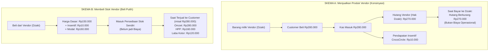

# ATURAN BISNIS VENDOR, FLEKSIBILITAS HARGA, DAN METODE HPP CROCSCIRCLE.ID

Dokumen ini merupakan aturan bisnis resmi dan final yang disahkan Owner untuk menangani kerja sama vendor (khususnya Dzaki), fleksibilitas harga jual & modal, pelacakan batch persediaan, serta metode penetapan HPP.

---

## 1. DUA SKEMA KERJA SAMA VENDOR

CrocsCircle memiliki 2 jenis kerja sama yang berbeda secara akuntansi dan operasional:

### Tabel Perbandingan Akuntansi

| Aspek | Skema A: Menjualkan Produk Vendor (Konsinyasi) | Skema B: Membeli Stok Vendor (Beli Putih) |
|---|---|---|
| **Status Kepemilikan Barang** | Milik Vendor sampai barang terjual ke customer | Milik CrocsCircle sejak barang diterima |
| **Pencatatan Stok** | `consignment_stock` (stok titipan) | `owned_stock` (persediaan aset sendiri) |
| **Arus Kas Masuk** | Diterima penuh dari customer (contoh: Rp280.000) | Diterima penuh dari customer (contoh: Rp280.000) |
| **Pengakuan Omzet CrocsCircle** | **Rp0** (Bukan omzet persediaan sendiri) | **Rp280.000** (Omzet penuh persediaan sendiri) |
| **Pengakuan Insentif CrocsCircle** | **Rp10.000** (Masuk ke Pendapatan Insentif Vendor) | **Rp0** (Keuntungan berasal dari selisih jual - modal) |
| **HPP Produk** | **Rp0** (CrocsCircle tidak menanggung modal beli) | **Rp160.000** (Rp150k dasar + Rp10k insentif Dzaki) |
| **Kewajiban ke Vendor** | **Rp270.000** (Tercatat sebagai Hutang Konsinyasi) | **Rp0** (Sudah diselesaikan saat pembelian awal) |
| **Penyelesaian ke Vendor** | Pelunasan kewajiban hutang konsinyasi (bukan biaya) | Pembayaran faktur pembelian persediaan |

---

## 2. ATURAN FLEKSIBILITAS HARGA (JUAL & MODAL)

### A. Harga Jual Fleksibel (Negosiasi Customer)
1. **Harga Katalog Sebagai Referensi:** Harga pada `MASTER_PRODUK` atau `VARIAN_PRODUK` hanyalah harga acuan awal.
2. **Snapshot Harga Aktual:** Setiap transaksi penjualan (`PENJUALAN` & `DETAIL_PENJUALAN`) wajib mencatat `selling_price` riil hasil kesepakatan kasir/admin dengan pembeli.
3. **Imunitas Data Historis:** Perubahan harga katalog di kemudian hari **tidak boleh** mengubah riwayat harga transaksi yang sudah terjadi.

### B. Harga Modal Fleksibel (Multi-Vendor & Multi-Batch)
1. **Tidak Ada HPP Tunggal:** HPP tidak boleh dikunci di master produk karena produk yang sama bisa dibeli dari vendor berbeda pada waktu yang berbeda dengan modal berbeda.
2. **Komponen Biaya Perolehan:** Biaya perolehan stok mencakup:
   $$\text{Unit HPP} = \text{Harga Dasar Beli} + \text{Insentif Vendor Khusus (jika ada)} + \text{Alokasi Ongkir Masuk (jika dikapitalisasi)}$$
3. **Pencatatan Batch:** Setiap penerimaan barang supplier menghasilkan `batch_id` yang mencatat jumlah awal, jumlah sisa, dan modal per unit.

---

## 3. METODE PENENTUAN HPP MULTI-BATCH: REKOMENDASI FIFO

Ketika produk yang sama memiliki stok dari beberapa batch dengan harga modal berbeda:

### A. Perbandingan Metode
1. **FIFO (First-In, First-Out) — (Rekomendasi Utama Antigravity)**
   - *Cara Kerja:* Barang yang pertama kali dibeli dari supplier dianggap sebagai barang yang pertama kali terjual.
   - *Kelebihan untuk CrocsCircle:*
     - Sangat akurat dan mencerminkan arus fisik sepatu di gudang/toko.
     - Sangat mudah diaudit di Google Sheets karena setiap baris `DETAIL_PEMBELIAN` dapat melacak kolom `remaining_qty`.
     - Tidak menimbulkan distorsi saat ada promo modal murah atau kenaikan harga supplier.
2. **Weighted Average (Rata-rata Bergerak)**
   - *Cara Kerja:* Setiap ada pembelian baru, harga modal rata-rata dihitung ulang:
     $$\text{HPP Rata-rata} = \frac{\text{Total Nilai Stok Lama} + \text{Total Nilai Pembelian Baru}}{\text{Total Kuantitas Stok}}$$
   - *Kelemahan:* Perlu kalkulasi ulang otomatis pada setiap baris database saat retur atau koreksi stok, lebih rawan desinkronisasi pada Google Sheets jika ada transaksi disisipkan mundur.
3. **Specific Identification (Pilihan Manual Admin)**
   - *Cara Kerja:* Kasir memilih batch mana yang terjual.
   - *Kelemahan:* Terlalu rumit untuk operasional kasir bazar yang cepat.

> **Keputusan Rekomendasi:** Gunakan **FIFO Otomatis** sebagai default sistem. Sistem otomatis memotong `remaining_qty` dari batch tertua yang masih tersedia saat konfirmasi penjualan.

---

## 4. FORMULA KEUANGAN FINAL CROCSCIRCLE.ID

$$\text{Pendapatan Bersih Operasional} = \text{Omzet Penjualan Stok Sendiri} + \text{Pendapatan Insentif Vendor (Konsinyasi)}$$

$$\text{Laba Kotor} = \text{Pendapatan Bersih Operasional} - \text{Total HPP Stok Sendiri Terjual}$$

$$\text{Laba Bersih} = \text{Laba Kotor} - \text{Total Pengeluaran Operasional}$$

Jika $\text{Laba Bersih} > 0$:
- **Owner 1 (Hafiz):** $\text{Laba Bersih} \times 20\%$
- **Owner 2 (Harits):** $\text{Laba Bersih} \times 20\%$
- **Dana Darurat:** $\text{Laba Bersih} \times 10\%$
- **Keuntungan Ditahan:** $\text{Laba Bersih} \times 50\%$

Jika $\text{Laba Bersih} \le 0$, seluruh alokasi keuntungan bernilai **Rp0**.

---

## 5. SIMULASI TRANSAKSI (DZAKI)

Berikut dua simulasi nyata untuk membuktikan bahwa kedua skema tidak saling tercampur.

---

### SIMULASI 1: PENJUALAN PRODUK TITIPAN DZAKI (KONSINYASI)

**Skenario:**
- Barang: Crocs Classic Pink M5 (Milik Dzaki).
- Harga jual ke customer: **Rp280.000** (dibayar QRIS oleh customer).
- Insentif CrocsCircle: **Rp10.000**.
- Hak Dzaki (Kewajiban): **Rp270.000**.

#### 1. Pencatatan Saat Transaksi Terjadi (`PENJUALAN` & `DETAIL_PENJUALAN`):
- Arus Kas Masuk: **+Rp280.000** (Uang masuk ke rekening CrocsCircle).
- Klasifikasi Item: `item_type = CONSIGNMENT`, `vendor_id = VND-DZAKI`.
- Dampak Finansial CrocsCircle:
  - Omzet Stok Sendiri: **Rp0**
  - Pendapatan Insentif Vendor: **+Rp10.000**
  - HPP Produk: **Rp0**
  - Laba Kotor Transaksi: **+Rp10.000**
- Pencatatan Kewajiban Vendor (`DETAIL_PENJUALAN`):
  - `vendor_payable = Rp270.000`
  - `settlement_status = UNPAID`
  - Saldo Hutang ke Dzaki: bertambah **Rp270.000**.

#### 2. Pencatatan Saat CrocsCircle Mentransfer Rp270.000 ke Dzaki (`SETTLEMENT_VENDOR`):
- Arus Kas Keluar: **-Rp270.000**.
- Status `settlement_status` pada transaksi terkait berubah menjadi `PAID`.
- Saldo Hutang ke Dzaki berkurang **Rp270.000** (Lunas).
- **PENTING:** Transaksi ini **TIDAK** masuk ke tabel `PENGELUARAN` operasional bulanan, sehingga laba bersih CrocsCircle tetap murni Rp10.000 dan tidak berkurang menjadi minus!

---

### SIMULASI 2: PEMBELIAN STOK DARI DZAKI (BELI PUTIH) & PENJUALANNYA

**Skenario:**
- Barang: Crocs Bape Black M8.
- Dibeli dari Dzaki untuk persediaan sendiri:
  - Harga dasar: **Rp150.000**
  - Insentif pembelian Dzaki: **Rp10.000**
  - Total Biaya Perolehan (HPP per unit): **Rp160.000**
- Sepatu kemudian terjual ke customer seharga **Rp290.000** (hasil tawar-menawar).

#### 1. Pencatatan Saat Pembelian Stok (`PEMBELIAN_STOK` & `DETAIL_PEMBELIAN`):
- Arus Kas Keluar: **-Rp160.000** ke Dzaki.
- `physical_stock` bertambah 1 pasang (stok milik CrocsCircle).
- Terbentuk `batch_id = BTC-202611-005` dengan `unit_cost = Rp160.000` dan `remaining_qty = 1`.
- **Dampak ke Laba Bersih Bulan Berjalan:** **Rp0** (Persediaan adalah aset, belum menjadi beban).

#### 2. Pencatatan Saat Barang Terjual ke Customer (`PENJUALAN` & `DETAIL_PENJUALAN`):
- Arus Kas Masuk: **+Rp290.000** (Harga jual aktual).
- Sistem memotong 1 unit dari `BTC-202611-005` (`remaining_qty = 0`).
- Klasifikasi Item: `item_type = OWNED`.
- Dampak Finansial CrocsCircle:
  - Omzet Penjualan Stok Sendiri: **+Rp290.000**
  - HPP Produk Terjual: **-Rp160.000**
  - Laba Kotor Transaksi: **+Rp130.000** ($\text{Rp290.000} - \text{Rp160.000}$).
  - Kewajiban ke Vendor: **Rp0** (Sudah lunas di awal).

---

### PERBANDINGAN LAPORAN KEUANGAN JIKA KEDUA TRANSAKSI TERJADI DI BULAN YANG SAMA

Misalkan biaya operasional bulan itu adalah Rp40.000:

| Baris Laporan Keuangan | Dari Transaksi 1 (Konsinyasi Dzaki) | Dari Transaksi 2 (Beli Putih Dzaki) | Total Laporan Keuangan CrocsCircle |
|---|---|---|---|
| **Omzet Bruto Customer** | Rp280.000 | Rp290.000 | Rp570.000 (Kas masuk bruto) |
| **Omzet Stok Sendiri** | Rp0 | Rp290.000 | **Rp290.000** |
| **Pendapatan Insentif Vendor** | Rp10.000 | Rp0 | **Rp10.000** |
| **Pendapatan Bersih Operasional** | **Rp10.000** | **Rp290.000** | **Rp300.000** |
| **Total HPP Stok Sendiri** | Rp0 | Rp160.000 | **Rp160.000** |
| **Laba Kotor** | **Rp10.000** | **Rp130.000** | **Rp140.000** |
| **Pengeluaran Operasional** | - | - | **Rp40.000** |
| **Laba Bersih** | - | - | **Rp100.000** |

#### Alokasi Keuntungan Bersih (Rp100.000):
- Owner 1 (20%): **Rp20.000**
- Owner 2 (20%): **Rp20.000**
- Dana Darurat (10%): **Rp10.000**
- Keuntungan Ditahan (50%): **Rp50.000**

**Audit Rekonsiliasi Kas:**
- Kas masuk bruto: $+280.000 + 290.000 = +570.000$
- Kas keluar beli stok: $-160.000$
- Kas keluar setor hak Dzaki: $-270.000$
- Kas keluar operasional: $-40.000$
- Sisa Saldo Kas Riil: $+570.000 - 160.000 - 270.000 - 40.000 = \mathbf{+100.000}$ (Tepat sama dengan Laba Bersih yang dialokasikan!).
- Tidak ada uang hilang dan tidak ada pencatatan ganda.

---

## 6. PENYESUAIAN STRUKTUR TABEL DATABASE

Untuk mewadahi skema ini, skema database disempurnakan dengan tabel dan kolom berikut:

### 1. Tabel Baru: `VENDORS`
Menyimpan profil vendor dan kebijakan insentif masing-masing:
- `vendor_id` (PK, contoh: `VND-DZAKI`, `VND-SHOPEE`)
- `vendor_name` ("Dzaki", "Shopee Averocs")
- `contact_person`
- `phone`
- `consignment_fee_type` (`FIXED_PER_UNIT` atau `PERCENTAGE`)
- `default_fee_value` (contoh: 10000)
- `purchase_incentive_default` (contoh: 10000 untuk Dzaki, 0 untuk lainnya)
- `is_active` (TRUE/FALSE)
- `notes`

### 2. Tabel Baru: `SETTLEMENT_VENDOR`
Menyimpan faktur penyelesaian/transfer pelunasan hak vendor:
- `settlement_id` (PK, contoh: `STL-202611-001`)
- `settlement_date` (Tanggal transfer ke vendor)
- `vendor_id` (FK ke `VENDORS`)
- `total_amount_paid` (Nominal rupiah yang ditransfer)
- `payment_method` (`TRANSFER_BCA`, `QRIS`, `CASH`)
- `bank_reference` (Nomor referensi / bukti transfer)
- `receipt_url` (Link bukti bayar)
- `notes` (Keterangan)
- `created_by` (Akun kasir/owner)
- `created_at`

### 3. Pembaruan Tabel: `DETAIL_PENJUALAN`
Menambahkan kolom penentu status kepemilikan dan hak vendor:
- `sales_detail_id` (PK)
- `sales_id` (FK)
- `variant_id` (FK)
- `item_ownership` (`OWNED` / `CONSIGNMENT`)
- `vendor_id` (FK ke `VENDORS`, jika konsinyasi)
- `batch_id` (FK ke `DETAIL_PEMBELIAN`, jika owned)
- `quantity` (Jumlah unit)
- `selling_price` (Harga jual aktual yang disepakati)
- `hpp_unit` (HPP aktual jika owned, 0 jika konsinyasi)
- `vendor_payable_unit` (Hak vendor per unit jika konsinyasi)
- `crocs_incentive_unit` (Insentif CrocsCircle per unit jika konsinyasi)
- `subtotal` (`quantity * selling_price`)
- `total_hpp` (`quantity * hpp_unit`)
- `total_vendor_payable` (`quantity * vendor_payable_unit`)
- `total_crocs_incentive` (`quantity * crocs_incentive_unit`)
- `settlement_status` (`NOT_APPLICABLE` jika owned; `UNPAID` / `PAID` jika konsinyasi)
- `settlement_id` (FK ke `SETTLEMENT_VENDOR`, diisi saat dilunasi)

### 4. Pembaruan Tabel: `DETAIL_PEMBELIAN` (Pelacakan Batch & FIFO)
- `purchase_detail_id` (PK / `batch_id`)
- `purchase_id` (FK)
- `variant_id` (FK)
- `quantity` (Jumlah beli awal)
- `remaining_qty` (Sisa stok belum terjual dari batch ini untuk FIFO)
- `base_cost` (Harga modal dasar)
- `vendor_incentive` (Insentif perolehan vendor jika ada)
- `unit_cost` (`base_cost + vendor_incentive`)
- `subtotal` (`quantity * unit_cost`)

---

## 7. KESIMPULAN & KESIAPAN IMPLEMENTASI

Rancangan ini telah menyelesaikan:
1. Pemisahan mutlak antara penjualan konsinyasi Dzaki dan penjualan stok milik CrocsCircle.
2. Mekanisme fleksibilitas harga jual hasil negosiasi admin dengan customer.
3. Mekanisme fleksibilitas harga modal per vendor & per batch dengan penentuan HPP metode FIFO otomatis.
4. Jaminan rekonsiliasi kas tidak dobel catat saat melunasi hak vendor.
